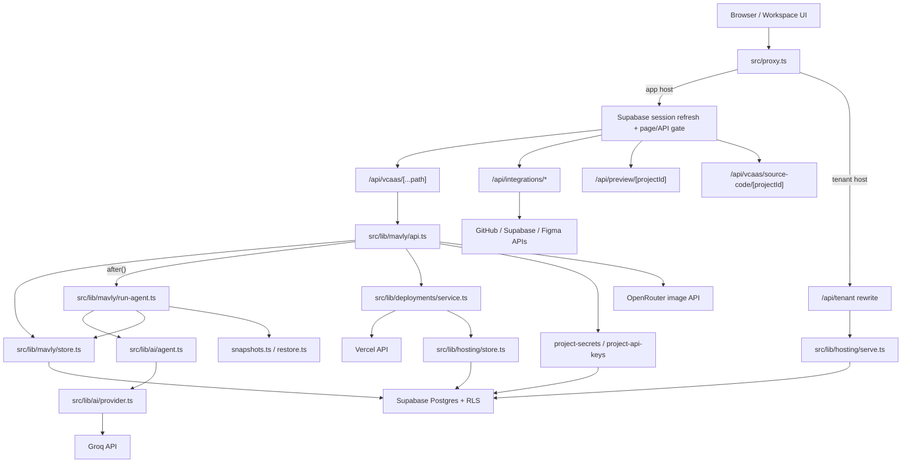
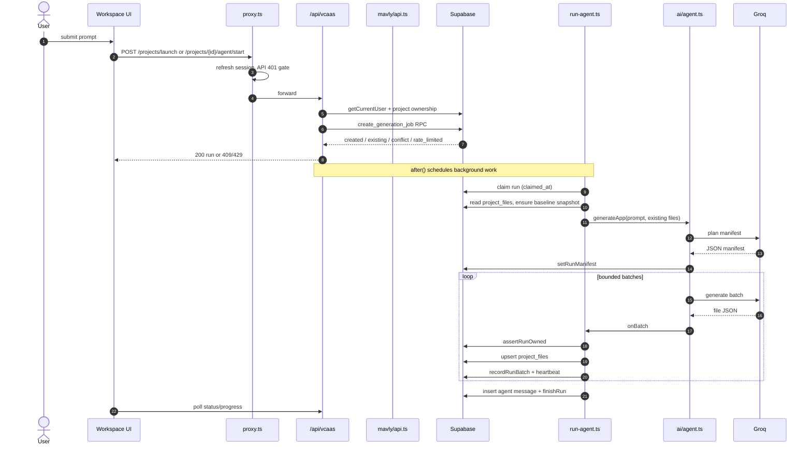
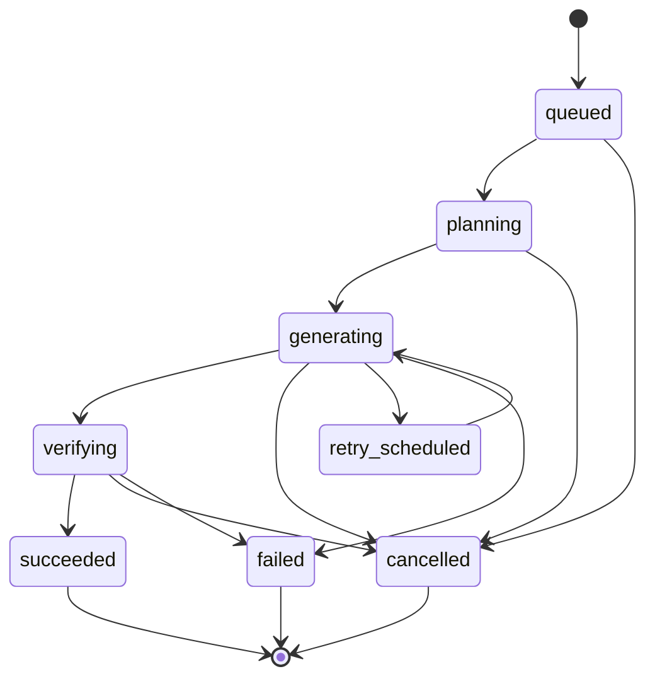

# MAVLY — Architecture & Production-Readiness Audit

**Repository:** `/Users/ashadali/Mavly`  
**Branch / commit inspected:** `main` @ `bd232f6`  
**Method:** static inspection only — source read, grep, tests counted, migrations read, official provider docs fetched.  
**No automated verification was run.** Per `AGENTS.md`, I did not run `npm test`, lint, `tsc`, build, `dev`, a server, a browser probe, a migration, or a deployment.  
**No application source, configuration, database, environment, dependency, or deployment was modified.** This report file was created at the operator's explicit request. The worktree otherwise still contains only the pre-existing untracked `mavly-structure.txt`.  
**Confidence legend:** **VERIFIED** = directly read in code/SQL/docs; **PARTIALLY VERIFIED** = mechanism read but runtime effect depends on config/data; **INFERRED** = reasoned from code, not exercised; **UNKNOWN** = not determinable from the repository.

---

## Section 1 — Executive Summary

Mavly is a real, working AI website *source-code generator* with genuine authentication, project ownership, RLS, durable-ish run checkpoints, restore points, static preview, optional static publishing, and encrypted integration storage. It is **not** yet a full-stack application platform: it generates text files for a fixed Next.js App Router shape, never installs dependencies, never builds, never runs the generated code, never applies database migrations, and never verifies a user journey.

The most important verified findings are:

1. **Shared hosting is not safe to enable yet.** A shared republish flips `project_deployments.status` to `queued`, while the public resolver requires `status = 'ready'`. The live site therefore 404s for the whole republish, and a failed republish leaves it 404ing permanently (`src/lib/deployments/store.ts:129-150`, `supabase/migrations/14_shared_hosting.sql:484`, `src/lib/deployments/service.ts:454-464`).
2. **The shared publish readiness probe is ordered wrongly by construction.** The probe runs before the row is written as `ready`, so a first publish always records `mavly_domain_status = 'pending'`; it can only become `verified` on a later status poll (`service.ts:543` vs `:556`, resolver `14:484`).
3. **Cohort removal is not an off-switch.** Tenant serving checks only whether shared mode is enabled, not whether the project is still in `MAVLY_SHARED_HOSTING_PROJECTS` (`src/lib/hosting/config.ts:75-77`, `src/lib/hosting/serve.ts:96-105`). This contradicts `MAVLY_SHARED_HOSTING.md:207`.
4. **1,000 simultaneous generations cannot be admitted.** Admission is capped at **2 active runs per user and 8 globally** (`10_generation_jobs.sql:315-399`). The 1,000-request target is a design target, not a capacity claim.
5. **There is no autonomous worker.** Generation relies on Next.js `after()` inside a route with `maxDuration = 300` (`src/app/api/vcaas/[...path]/route.ts:24-25`). A run that outlives that window is interrupted and requires a user-initiated resume. This is the single largest reliability limitation.
6. **The generation engine is a single orchestrator, not an agent with tools.** It plans a file manifest, generates bounded batches, validates JSON/paths/sizes, checkpoints each batch, and repairs truncation. It cannot inspect a repo via tools, run commands, read errors, build, test, or verify behavior.
7. **Security fundamentals are strong.** No service-role key is used anywhere in `src`; every created table enables RLS; ownership is checked through the caller’s RLS-scoped client; missing and foreign projects return the same non-enumerating 403; project secrets are write-only ciphertext with metadata-only grants; previews are sandboxed with no same-origin privileges.
8. **Release protection is weak.** There are no CI workflows (`.github` contains only an asset), ESLint is configured to disable nearly every useful rule, and the 35 test files / 374 declared cases are pure/mocked or assert on source/SQL text. `run-agent.ts`, tenant serving, the deployment service, snapshots/restore, integrations, and API keys have little or no direct test coverage.

**Recommended direction:** do not start with a sandbox, a queue vendor, or Android. First make the existing shared-hosting state machine correct and make release gates real. Then add a durable lease-based job runner, then a bounded verification sandbox, then runtime profiles and full-stack generation, then backend-capable hosting. Each phase should reuse the existing `run-agent`, `checkpoints`, `snapshots`, `hosting`, and `project-secrets` modules rather than creating parallel systems.

---

## Section 2 — Repository Reality

### 2.1 Baseline facts

| Fact | Evidence | Confidence |
|---|---|---|
| Branch `main`, HEAD `bd232f6` | `git branch --show-current`, `git log` | VERIFIED |
| 369 files under `src` | `find src -type f \| wc -l` | VERIFIED |
| 14 SQL migrations | `supabase/migrations/` | VERIFIED |
| 35 test files, 374 declared `test(...)` cases, ~1,256 asserts | static count of `tests/*.test.ts` | VERIFIED (count only; pass status UNKNOWN) |
| No `.github/workflows` | `.github/assets/...` only | VERIFIED |
| Next.js 16 / React 19 / Tailwind 4 | `package.json` | VERIFIED |
| Active generation provider is Groq | `src/lib/ai/provider.ts` → `groq.ts` | VERIFIED |
| OpenRouter chat client preserved but not in the active generation path; image API still uses OpenRouter | `src/lib/ai/openrouter.ts`, `openrouter-images.ts`, `provider.ts` | VERIFIED |
| Vercel publishing is opt-in | `MAVLY_VERCEL_DEPLOYMENTS_ENABLED` + `VERCEL_API_TOKEN` | VERIFIED |
| Shared hosting is opt-in | `MAVLY_HOSTING_MODE=shared` + cohort | VERIFIED |

### 2.2 What Mavly can demonstrably do today

These are capabilities with coherent implementation and persistence, **not runtime-certified behaviors**:

- Google/GitHub OAuth sign-in, server-verified sessions, proxy gating of pages and APIs.
- Project create/list/get/update/delete, ownership registration, RLS-scoped access.
- Prompt → generated Next.js App Router source files (`package.json`, `app/layout.tsx`, `app/page.tsx`, `app/globals.css`, API route files when needed, plus a standalone `preview.html`).
- Bounded generation with manifest planning, batches, JSON repair, truncation recovery, path/size validation, per-path SHA-256 checkpoints, resume, and cooperative cancel.
- Restore points: every completed source-changing run leaves a snapshot; the UI exposes **Restore Code**; the restore captures the pre-restore state first; stale restores are refused by source hash.
- Static preview of `preview.html` (or an imported `index.html` / `public/index.html` + local assets) inside a sandboxed, opaque-origin iframe with `connect-src 'none'`.
- Source ZIP download.
- GitHub App connect/push/import with encrypted user-to-server tokens.
- Figma PAT connection, frame reading, and bounded design context injection when a Figma link is present.
- User-owned Supabase OAuth connection with organization/project discovery and verified selection.
- Write-only encrypted project secrets (create/list metadata/update/delete).
- Image generation via OpenRouter’s image API, returned as base64 to the workspace; not persisted, not billed.
- Optional static publishing to Vercel with a Mavly-derived `<project-id>.mavly.xyz` domain; real unpublish (domain detach + production deployment removal).
- Optional shared hosting from Supabase-stored immutable versions and a tenant runtime.

### 2.3 Partially implemented / not demonstrable

| Area | Reality | Confidence |
|---|---|---|
| Full-stack generation | Source files only; no install, build, run, migration, auth wiring, or tests | VERIFIED |
| Application execution | Generated code is data and is never executed | VERIFIED |
| Generated-app secrets | Secrets are stored but **not injected** into generated apps or published output | VERIFIED |
| Project API keys | Store + UI exist, but no API route uses them for authentication | VERIFIED |
| Mavly billing/credits | Credit pack config and UI helpers exist; no credit engine or settlement path in the active generation route | VERIFIED |
| Payments for generated apps | No provider adapter, webhook consumer, or payment state machine | VERIFIED |
| Background jobs/cron for generated apps | UI exists (`CronJobsModal`) but no backend execution | VERIFIED |
| Custom domains | Domain UI/status helpers exist; no general custom-domain provisioning beyond the Vercel publish path | PARTIALLY VERIFIED |
| Deployment rollback | Published versions are retained, but no rollback API/UI was found | VERIFIED |
| Autonomous job recovery | Resume is user-triggered; `after()` is opportunistic | VERIFIED |

### 2.4 Unknowns

- Whether the production Supabase database has migrations 03/07/08/09/10/11/12/13/14 applied.
- Actual Groq rate limits, latency, and failure rates for the configured model.
- Whether `mavly.xyz` wildcard DNS, wildcard TLS, and certificate issuance are configured.
- Vercel plan/terms eligibility for Mavly-managed customer hosting.
- Whether any external Cloudflare/Worker/proxy layer rewrites tenant hosts.
- Real concurrency behavior of Supabase connection pooling under generation load.
- Whether generated apps satisfy any real user journey — no such test exists in the repo.

---

## Section 3 — Existing File Responsibility Map

| Capability | Entry point | Core implementation | Persistence | Tests | Status |
|---|---|---|---|---|---|
| Marketing/auth pages | `src/app/(marketing)`, `src/app/login` | `src/lib/auth/*`, `src/lib/supabase/*` | `profiles` | `auth-*`, `api-guards` | Working |
| Session/API gate | `src/proxy.ts` | `src/lib/api-access.ts`, `src/lib/supabase/proxy.ts` | Supabase Auth cookies | `api-access`, `api-guards` | Working |
| Vcaas auth/scope/ownership | `src/app/api/vcaas/[...path]/route.ts` | `_shared.ts`, `vcaas-scope.ts`, `project-ownership.ts` | `projects` | `route-authorization`, `vcaas-scope`, `ownership-*` | Working |
| Project CRUD/launch | `src/lib/mavly/api.ts` | `src/lib/mavly/store.ts` | `projects`, `project_files`, `project_messages` | partial | Working |
| Generation admission | `create_generation_job` RPC | `supabase/migrations/10_generation_jobs.sql` | `project_runs` | `generation-migration` (SQL text assertions) | Working, capped at 8 global |
| Generation driver | `src/lib/mavly/run-agent.ts` | `src/lib/ai/agent.ts`, `src/lib/ai/provider.ts`, `groq.ts` | `project_runs`, `project_run_batches`, `project_files` | `generation-reliability`, `generation-checkpoints` (pure/mocked) | Partial |
| Provider retry | `src/lib/ai/retry.ts` | Groq client | run metadata | `provider-retry`, `groq-provider` | Working |
| File persistence | `src/lib/mavly/store.ts` | `writeFiles`, `listFiles` | `project_files` | indirect | Working but not transactional with checkpoints |
| Messages/runs | `src/lib/mavly/store.ts` | `insertMessage`, `finishRun`, `heartbeatRun` | `project_messages`, `project_runs` | indirect | Working |
| Snapshots/restore | `src/lib/mavly/snapshots.ts`, `restore.ts` | `RestoreCodeAction.tsx` | `project_snapshots`, `project_snapshot_files` | minimal | Working; concurrency not proven |
| Static preview | `/api/preview/[projectId]/...` | `src/lib/static-site.ts` | `project_files` | `static-site` | Working |
| Source ZIP | `/api/vcaas/source-code/[projectId]` | `src/lib/source-archive-cache.ts` | `project_files` | `routes` (text) | Working |
| Vercel publish/unpublish | `/api/vcaas/projects/{id}/deployments/*` | `src/lib/deployments/service.ts`, `store.ts`, `src/lib/vercel/*` | `project_deployments` | `deployment-host`, `deployments-unpublish`, `vercel-*` | Working, opt-in |
| Shared publishing | same routes when mode/cohort selected | `src/lib/hosting/store.ts`, `published-version.ts` | `project_published_versions`, `project_published_files` | `shared-hosting*` (mostly pure/text) | **Defective** |
| Tenant runtime | `/api/tenant/[[...path]]` via proxy rewrite | `src/lib/hosting/serve.ts`, `tenant-host.ts` | public RPCs | `tenant-host`, `shared-hosting` | Working but cohort gap |
| Domains | deployment service | `mavly-hostname.ts`, `domain-status.ts` | `project_deployments` | `deployment-host` | Partial |
| GitHub integration | `/api/integrations/github/*` | `src/lib/integrations/github/*` | `github_connections`, `github_repository_connections` | `github-installation` | Working |
| Customer Supabase integration | Retired; no runtime route | Historical migration 04 only | Historical tables retained | none | Retired |
| Figma integration | `/api/vcaas/projects/{id}/figma/*` | `src/lib/integrations/figma/*` | `figma_connections` | none found | Working, untested |
| Project secrets | `/api/vcaas/projects/{id}/secrets` | `src/lib/project-secrets/*` | `project_secrets` | `project-secrets` | Working |
| Project API keys | UI + store only | `src/lib/project-api-keys/*` | `project_api_keys` | none found | **Not wired** |
| Image generation | `/api/vcaas/projects/{id}/images/generate` | `src/lib/ai/openrouter-images.ts`, `image-models.ts` | none (ephemeral) | `image-generation*` | Working |
| Admin pages | `src/app/adminsh/*` | UI + helpers | varies | none found | UI-only / unknown |
| Observability | `src/lib/logs.ts`, `hosting/events.ts` | structured-ish logs | none | none | Partial |
| CI/release gates | none | — | — | — | **Missing** |

### 3.1 Overlaps and dangerous dependencies

- **One deployment row carries two state machines.** Vercel uses `status = ready` to mean “deployment is live.” Shared hosting reuses `ready` as the public resolver gate. Republish reuses `queued` for “attempt in progress,” which silently unpublishes the site. This coupling is the root cause of the shared-hosting defects.
- **`project_runs.status` and `project_runs.stage` are dual state.** `status` is coarse (`init/done/error`), `stage` is finer (`queued/validating/generating/retrying/completed/failed/cancelled/interrupted`). New code must read both; inconsistent writes are possible.
- **Generation writes cross two persistence boundaries.** `writeFiles` upserts `project_files`, then `recordRunBatch` writes `project_run_batches`, then `heartbeatRun` updates the run. These are separate statements/transactions.
- **Client contracts are duplicated.** `src/lib/api.ts`, `src/lib/vcaas.ts`, `src/lib/vcaas-types.ts`, and `src/lib/mavly/api.ts` all describe overlapping shapes; drift is likely.
- **UI advertises capabilities with no backend.** Payments, cron jobs, versions, analytics, API keys, and some domain actions have UI components but no active route/worker.
- **Two hosting paths share routes and env configuration.** A misconfigured cohort or missing migration changes behavior in the same endpoints used by the default Vercel path.

---

## Section 4 — Current Request Lifecycle

### 4.1 Current architecture



### 4.2 Sequence from submission to completion



### 4.3 Step evidence and failure modes

| Step | Evidence | Failure mode |
|---|---|---|
| Route duration | `[...path]/route.ts:24-25` (`maxDuration = 300`) | Run killed at 300s; no worker to continue |
| Auth | `_shared.ts:122` (`resolveVcaasContext`) | 401 |
| Scope | `vcaas-scope.ts:65` | Unknown path refused before work |
| Ownership | `_shared.ts:237` (`checkProjectAccess`) | Non-enumerating 403 |
| Admission | `10_generation_jobs.sql:315-436` | 409/429; stale runs marked interrupted after 10 min |
| Background start | `after()` in the route | Best-effort; not a durable queue |
| Claim | `run-agent.ts:88` | `claimed_at` token, no expiry |
| Baseline | `run-agent.ts:189` (`ensureBaseline`) | One baseline per run; reused on resume |
| Planning | `ai/agent.ts:1266-1295` | JSON repair; manifest required |
| Batch generation | `ai/agent.ts:487-703` | Truncation → smaller retry; `finish_reason: "length"` never success |
| Write | `store.ts:494-527` | Upsert batch; not transactional with checkpoint |
| Checkpoint | `store.ts:813-870` | Upsert `(run_id,batch_index)`; not claim-guarded |
| Completion | `store.ts:258-310` | Claim-guarded terminal write |
| Cancel | API `agent/cancel|stop` | Cooperative; cannot abort an in-flight provider call |
| Resume | `agent/resume` + `checkpoints.ts` | Verifies per-path hashes; refuses to skip mismatched files |

**Conclusion:** the happy path is coherent and recoverable, but it is a **request-scoped background job**, not a durable queue worker. At 1,000 concurrent submissions the system does not queue; it rejects most callers and may lose work when a function lifetime ends.

---

## Section 5 — Concurrency and Scaling Assessment

### 5.1 Verified limits

| Limit | Value | Evidence |
|---|---|---|
| Active runs per project | 1 | unique index / admission check, `10_generation_jobs.sql:99-132` |
| Active runs per user | **2** | `10_generation_jobs.sql:319` |
| Active runs globally | **8** | `10_generation_jobs.sql:318` |
| Stale run threshold | 10 minutes since heartbeat | `10_generation_jobs.sql:320` |
| Admission serialization | `pg_advisory_xact_lock(hashtext('mavly:create_generation_job'))` | `10_generation_jobs.sql:341` |
| Route max duration | 300s | `[...path]/route.ts:24-25` |
| Provider | Groq, server-side | `provider.ts`, `groq.ts` |
| Publish rate limit | 6/user and 60/global per 5 min, per instance | `hosting/publish-limits.ts:19-22` |
| Image generation limit | 5/user and 40/instance per 10 min, best effort | `mavly/image-limits.ts`, baseline |

### 5.2 What happens at 1,000 simultaneous submissions

**Verified by design, not by load test:**

- Submissions 9–1,000 receive `rate_limited` (`scope: "global"`) immediately. The platform cannot admit them.
- Even if the global cap were raised, each admitted run occupies a serverless invocation for up to 300s. There is no queue, no `available_at`, no worker pool, and no dead-letter state.
- `after()` is opportunistic. If the invocation is frozen or terminated, the run remains `queued/validating/generating` until the 10-minute stale sweep marks it `interrupted`; a human must press Resume.
- Every run performs multiple Supabase round trips per batch and multiple Groq calls. Database connection pressure, provider 429s, and retry amplification are unmeasured.
- The advisory lock serializes all admissions. That is correct for the 8-slot cap, but it becomes a single hot row/lock at high submission rates.
- Duplicate delivery is only partially defended: the one-active-run index blocks a second active run per project, but the shipped client **never sends an idempotency key** (no `clientRequestId`/`idempotencyKey` in `src/components` or `src/lib/vcaas.ts`).

**Conclusion:** the 1,000-request target is not supported. The correct claim today is “a small number of concurrent runs, capped at 8 globally, with best-effort execution and manual resume.”

### 5.3 Recommended durable job state machine

Keep the existing `project_runs` table and `stage` column; extend it rather than creating a parallel queue.



**Transition rules:**

- `queued → planning` only by a worker holding a valid lease.
- `planning → generating` only after the manifest is persisted.
- `generating → verifying` only after all batches are checkpointed and file hashes verified.
- `verifying → succeeded` only after the verification policy for the project’s runtime profile passes or explicitly records `not_applicable` / `pending_external`.
- Any active state → `cancelled` when `cancel_requested_at` is set; the worker must stop before the next batch and must not write after the cancellation is observed.
- Any active state → `retry_scheduled` only with a bounded attempt count and a persisted `available_at`.
- `failed` is terminal for the attempt, not necessarily for the project; a new attempt gets a new attempt id.

**Required durable fields (proposed migration 15):**

- `attempt_count`, `lease_expires_at`, `worker_id`, `available_at`, `priority`, `cancel_requested_at`, `last_error_class`, `dead_lettered_at`.
- A `claim_generation_job(worker_id, lease_seconds)` RPC that atomically selects the oldest eligible row with `FOR UPDATE SKIP LOCKED`, sets the lease, and returns one job.
- A `project_run_attempts` table if per-attempt history is needed; otherwise reuse `project_run_batches` and `attempt_count`.

**Do not add Redis/Kafka/Temporal yet.** The verified limitation is “no worker and no lease,” not “Postgres cannot queue.” A Postgres-backed claim RPC plus an external worker process is the minimum change.

### 5.4 Load-test design (to be executed later, not now)

| Stage | Concurrent submissions | Purpose | Pass criteria (hypotheses to validate) |
|---|---:|---|---|
| Smoke | 10 | Correctness of admission/claim | No duplicate active run; all admitted runs reach a terminal state |
| Stage 1 | 100 | Queue + worker behavior | 100% admitted or explicitly queued; p95 queue delay < 30s; no lost batches |
| Stage 2 | 250 | DB/provider pressure | No connection exhaustion; provider 429 rate measured; retries bounded |
| Stage 3 | 500 | Saturation | Backlog visible; fair scheduling; no starvation; cancel works |
| Stage 4 | 1,000 | Design target | Every request has a durable state; no silent loss; cost per success measured |

**Metrics:** queue delay, time to first progress event, completion latency p50/p95/p99, success rate, timeout/interrupt rate, retry count and reason, provider 429s, DB connections/CPU/lock waits, worker CPU/memory, sandbox startup latency, cost per successful project.

**Test isolation:** mock the provider first to measure queue/DB behavior; then run a small real-provider canary. Never mix the two in one result.

---

## Section 6 — Project Memory and Recovery

### 6.1 Current persistence by category

| Memory category | Current storage | Status |
|---|---|---|
| Conversation history | `project_messages` | VERIFIED |
| Project requirements/constraints | User prompt stored on `project_runs.prompt`; no durable requirements model | Partial |
| Architecture decisions | Not stored as decisions; only generated files | Missing |
| Task/execution state | `project_runs.status/stage`, `generation_manifest`, `project_run_batches` | Partial |
| File versions/diffs | `project_files` (current only), `project_snapshots` + `project_snapshot_files` | Partial |
| Build/test results | None — no build or test runs | Missing |
| Integration configuration status | `github_connections`, `figma_connections` | Partial |
| External prerequisites | Not modeled; UI copy only | Missing |
| Deployment state | `project_deployments`, `project_published_versions` | Partial |
| Recovery checkpoints | Baseline snapshot, per-batch hashes, pre-restore snapshot | Working |

### 6.2 What is good

- **Baseline is created once before the first write** and reused on resume (`run-agent.ts:184-189`), so “restore to before this run” remains meaningful.
- **Checkpoints verify content, not just completion.** `verifyCheckpointBatches` compares each path’s stored SHA-256 to the current file; mismatches are regenerated (`checkpoints.ts:38-80`).
- **Truncation is never success.** `finish_reason: "length"` discards the batch, persists prior valid batches, and retries with a smaller batch (`ai/agent.ts:17-19`, `:529-568`).
- **Restore is a two-way door.** The pre-restore state is captured before replacing files; a stale restore is refused by `expectedSourceHash` (`restore.ts:60-120`).
- **Terminal writes are claim-guarded.** `finishRun` only updates when `claimed_at` still matches and `finished_at` is null (`store.ts:258-310`).

### 6.3 Verified gaps

1. **`assertRunOwned` fails open on a transient store read error.** It logs and returns instead of throwing (`run-agent.ts:127-136`). A stale worker can then proceed to write.
2. **File writes and batch checkpoints are not lease-guarded at the database boundary.** `onBatch` checks ownership, then `writeFiles` upserts, then `recordRunBatch` upserts, and only the heartbeat is claim-guarded (`run-agent.ts:242-270`, `store.ts:813-836`). A resumed worker and a stale worker can interleave.
3. **The lease has no expiry.** `claimed_at` is a token, not a deadline. Stale recovery is based on `heartbeat_at`, and a live worker that is slow between heartbeats can be marked `interrupted` by another admission.
4. **No automatic resume.** `agent/resume` is user-authenticated and user-triggered; there is no worker to pick up an interrupted run.
5. **No decision/requirement memory.** The agent receives the current file index and generated context, not a durable record of “why” previous choices were made.
6. **No build/test evidence.** There is nothing to remember because nothing is built or tested.
7. **Restore is not a single transaction.** Snapshot creation and file replacement are separate operations; concurrent restores or a crash between them can leave an inconsistent recovery point (INFERRED).

### 6.4 Proposed versioned project-memory model

Add one append-only event table and treat the existing tables as materialized views:

```
project_memory_events
  id uuid pk
  project_id text fk
  run_id uuid null
  attempt int null
  kind text            -- requirement | decision | plan | file_change | checkpoint | verification | integration | deployment | prerequisite | error
  schema_version int
  payload jsonb        -- redacted, no secrets
  source_hash text     -- content hash after the event, when applicable
  created_at timestamptz
  visibility text      -- user | internal
```

**Checkpoint envelope (persisted per meaningful step):**

| Field | Purpose |
|---|---|
| `user_id`, `project_id` | ownership and isolation |
| `run_id`, `attempt` | execution identity |
| `source_version` / `source_hash` | exactly what state this checkpoint describes |
| `completed_steps`, `pending_steps` | resume position |
| `modified_paths` + per-path hashes | replay safety |
| `verification_results` | build/test/smoke statuses |
| `outstanding_errors` | bounded, secret-free error codes/messages |
| `recovery` | baseline snapshot id, pre-restore snapshot id |
| `schema_version`, `created_at` | forward compatibility |

**Rules:**

- Never store secret values, tokens, payment credentials, or raw provider headers. Store secret **ids** and status only.
- Every event is append-only; current state is a projection, not an overwrite.
- Redact prompts/messages if they may contain user secrets; keep a hash for traceability.
- Resume reads the latest checkpoint whose `source_hash` matches the current files; otherwise it regenerates the affected paths.

### 6.5 Crash recovery matrix

| Crash point | Current behavior | Required behavior |
|---|---|---|
| Before manifest | Run interrupted; resume re-plans | Same, with attempt id and bounded replan |
| After manifest, before batch | Resume continues at `nextBatchIndex` | Same |
| Mid-batch (provider call) | No partial file write; batch retried | Same; provider call must be idempotent or repeated safely |
| After file upsert, before checkpoint | Files present without checkpoint; resume regenerates | Add a write-ahead intent or reconcile by content hash |
| After checkpoint, before heartbeat | Checkpoint valid; heartbeat stale | Lease renewal must be independent of checkpoint success |
| Duplicate worker | Last-writer-wins possible | Fencing token on every write; lease check in SQL |
| User cancels | Cooperative; in-flight call continues | Persist `cancel_requested_at`; check before every write; abort provider call where supported |

---

## Section 7 — Sandbox Decision

### 7.1 What exists today

Mavly has **no execution sandbox**. The “preview” is a static document resolver:

- `resolveStaticPreview` picks `preview.html` or `index.html` / `public/index.html` and local assets (`src/lib/static-site.ts`).
- The preview route authenticates, checks ownership, and serves the document with `Content-Security-Policy: sandbox allow-scripts` and `connect-src 'none'`, no same-origin privileges (`src/app/api/preview/[projectId]/[[...path]]/route.ts:14-32`).
- No dependency installation, no build, no dev server, no command execution, no server-side runtime, no test runner.
- Published tenant sites are served as top-level documents with `nosniff`, `no-store`, and **no CSP** (`src/lib/hosting/serve.ts:48-60`), because generated pages use inline scripts.

This is a safe **static** preview, not a sandbox for arbitrary code.

### 7.2 Option comparison

| Criterion | Existing static preview | E2B | Vercel Sandbox | WebContainers | Hybrid |
|---|---|---|---|---|---|
| Supported project types | Static HTML + assets | Linux VMs; any language/toolchain | Linux microVMs; any toolchain | Browser Node.js; frontend/Node tooling | Varies by adapter |
| Backend runtime | None | Yes (inside VM) | Yes (inside VM) | No real server; browser emulation | Yes for build/test |
| Dependency install | No | Yes | Yes | Yes (npm in browser) | Yes |
| Command execution | No | Yes | Yes | Yes (browser process) | Yes |
| Dev server | No | Yes, via exposed ports | Yes, via exposed ports | Yes, browser-local | Yes |
| Preview networking | Same-origin app route, sandboxed | Provider URL / port | Provider URL / port | In-browser | Provider URL |
| Filesystem persistence | Supabase text files | Pause/resume; persistence docs | Persistent sandboxes, snapshots, drives | In-memory/browser | Depends |
| Snapshots | Project snapshots (text) | Pause saves FS + memory | Snapshots, persistent sandboxes | Browser state | Depends |
| Resource limits | N/A | 1–8 vCPU, 1–8 GiB, 1h/24h | 1–32 vCPU, 2–64 GB, 45m/24h | Browser tab | Depends |
| Startup latency | Immediate | Fast (provider claim) | Milliseconds (provider claim) | Milliseconds (provider claim) | Fast |
| Concurrency | N/A | 20/100/600/1100 by plan | 10/10,000 by plan | Client-side | Provider-dependent |
| Isolation | Static CSP sandbox | Linux VM | Firecracker microVM | Browser tab | VM |
| Outbound network | `connect-src 'none'` in preview | Configurable | Configurable; Secure Compute | Browser network | Must be policy-controlled |
| Secret exposure | None in preview | Secrets enter VM if injected | Secrets enter VM if injected | **Never** put secrets in browser | Must broker |
| Pricing (official, 2026) | $0 | $0.000014/vCPU-s + $0.0000045/GiB-s; plans $0/$150/$650/$1,150 | $0.128/active CPU-hr + $0.0212/GB-hr; creations $0.60/1M; Pro included quotas | Commercial license; exact terms UNKNOWN | Sum |
| Integration complexity | Already done | Medium | Low if already on Vercel (OIDC) | Low for frontend, high for backend | High |
| Vendor lock-in | None | Medium | Medium-high | High (StackBlitz API) | High |

**Sources:** Vercel Sandbox docs and pricing (fetched 2026-09; Firecracker microVMs, 10,000 concurrent on Pro, 24h max, 5-minute default timeout, 64 GB disk, 19 regions); E2B docs and pricing (fetched 2026; Linux VMs, pause/resume persistence, 20/100/600/1,100 concurrency, 1–8 vCPU / 1–8 GiB, CPU-only); WebContainers introduction (browser-based Node.js runtime, client-side execution, commercial usage terms). Provider claims are labeled as provider claims; none were exercised against Mavly.

### 7.3 Security analysis

A sandbox is **not** automatically a secure multi-tenant production environment. Required controls before any generated code runs:

- **Process/filesystem isolation:** one sandbox per run/attempt; no host mounts; no shared writable volumes across tenants.
- **Identity:** sandbox id bound to `(user_id, project_id, run_id, attempt)`; never accept a sandbox id from the browser without ownership proof.
- **Credentials:** do not inject long-lived Mavly secrets. Use short-lived, scoped tokens; broker external calls through Mavly; never put payment or integration secrets in a sandbox that runs model-generated code.
- **Egress:** default-deny or allowlist; block link-local/metadata endpoints; prevent SSRF to Supabase service endpoints, Vercel API, and internal networks.
- **Resource exhaustion:** CPU/memory/disk/PID/time caps; kill on timeout; cap output size; cap dependency install time.
- **Malicious dependencies:** install with a lockfile and a registry policy; do not run lifecycle scripts unless required; scan or at least record the dependency set.
- **Artifact handoff:** copy only declared build outputs back to Mavly; never trust sandbox-reported success without hashes/logs.
- **Production separation:** a development sandbox is ephemeral and untrusted; production hosting is a separate, verified deployment target. Never serve directly from a live sandbox.

### 7.4 Recommendation

**Smallest viable architecture:**

1. **Keep the existing static preview** for instant UI feedback. It is safe and already works.
2. **Add one verification sandbox adapter** — Vercel Sandbox if Mavly remains on Vercel (OIDC auth, colocation, 10k concurrency), otherwise E2B. Use it for install → typecheck → build → unit/smoke tests → optional headless browser checks. Do not expose it as the user’s preview.
3. **Do not use WebContainers for backend or secret-bearing work.** It is suitable later for an instant client-side frontend playground, not for verifying auth, payments, or database behavior.
4. **Hybrid only after the single-adapter path is proven.** A second adapter is justified when a verified limitation (region, quota, runtime, cost) appears, not before.

---

## Section 8 — Agentic Full-Stack Engine

### 8.1 What the current agent is

`generateApp` is a **single orchestrator with a fixed pipeline**, not a tool-using agent:

- **Plan:** one model call returns a JSON manifest of file paths and size estimates.
- **Generate:** bounded batches (max 8 files / 48 KB estimated) produce complete file contents.
- **Validate:** JSON parse/repair, path sanitization, file count/size caps, required create paths.
- **Checkpoint:** each validated batch is persisted with per-path hashes.
- **Repair:** invalid JSON or truncation triggers a compact retry or a smaller batch, bounded by `MAX_TRUNCATION_RECOVERIES = 16`.
- **No tools:** no shell, no browser, no test runner, no database, no HTTP calls, no repository search beyond an existing-file index.
- **No verification:** success means “files were generated and stored,” not “the app works.”

### 8.2 Capability assessment

| Capability | Current state | Gap |
|---|---|---|
| Requirement interpretation | Prompt + optional Figma summary | No structured requirements extraction |
| Planning/decomposition | File manifest only | No task graph, dependencies, acceptance criteria |
| File-aware context | Existing file index + selected contents, 120k char cap | No semantic retrieval, no symbol graph |
| Existing code understanding | Model sees current files in context | No AST/tool-based inspection |
| Tool selection/execution | None | No tools at all |
| Provider abstraction | `provider.ts` → Groq | One provider; no budget/routing |
| Streaming/timeouts | Non-streaming completion + timeout/retry | No token-level progress; 300s cap |
| Multi-step execution | Plan → batches | No verify/repair loop against real errors |
| Checkpoint/resume | Strong per-batch hashes | Lease gaps; user-triggered only |
| Cancellation | Cooperative between batches | Cannot abort in-flight provider call |
| Final verification | None | No build/test/smoke evidence |
| Infinite-loop prevention | Bounded retries/batches/time budget | No global cost budget |
| Partial results | Persisted batches + baseline restore | No explicit “incomplete” project status in UI |
| Context management | Char cap + omission notice | No summarization or durable memory |
| Decision history | None | No “why” record |

**Can it distinguish requested / existing / planned / applied / tested / verified / pending / failed?**  
It distinguishes **planned** (manifest), **applied** (files + batch hashes), and **failed** (run error). It does **not** distinguish **tested**, **verified**, or **pending external setup** because those states do not exist. This is the central product gap.

### 8.3 Durable task-state model

Use the existing run/batch tables and add explicit task records only where needed:

```
project_tasks
  id, project_id, run_id, parent_id
  kind            -- implement | integrate | migrate | verify | deploy | configure
  title, description
  status          -- pending | in_progress | blocked | done | failed | skipped
  acceptance      -- text/json acceptance criteria
  evidence        -- jsonb: build/test/deploy references
  blocked_by      -- external prerequisite id
  created_at, updated_at
```

A task is `done` only when its acceptance evidence exists. A `verify` task is `done` only with a recorded command/result. An `integrate` task is `done` only when the integration is connected **and** tested, not merely coded.

### 8.4 Single orchestrator vs multi-agent

**Recommendation: keep one orchestrator.** The verified failure modes are missing tools, missing verification, and missing durable workers — not insufficient agent count. Add specialized **tools** (sandbox exec, build, test, browser, DB migration, deployment) behind one orchestrator. Parallelize only independent, read-only work (e.g., generating unrelated files, running independent test suites) with explicit budgets and merge rules. Do not add a planner/coder/reviewer swarm before the single-agent verification loop is measured.

### 8.5 Full-stack generation model

Introduce an explicit **runtime profile** and **project manifest**:

```json
{
  "schemaVersion": 1,
  "runtime": "next-app-router",
  "packageManager": "npm",
  "services": {
    "database": { "provider": "supabase", "migrations": "supabase/migrations" },
    "auth": { "provider": "supabase", "roles": ["user", "admin"] },
    "storage": null,
    "payments": null,
    "email": null,
    "jobs": null
  },
  "env": [
    { "name": "NEXT_PUBLIC_SUPABASE_URL", "scope": "public", "required": true },
    { "name": "SUPABASE_SERVICE_ROLE_KEY", "scope": "server", "required": true }
  ],
  "verification": ["install", "typecheck", "build", "unit", "smoke"],
  "deployment": { "target": "vercel", "mode": "serverless" }
}
```

The agent must **derive** this manifest from the prompt and existing project, validate it against supported profiles, and refuse unsupported combinations rather than generating a plausible-looking but unrunnable project. Never hard-code one payment provider or one deployment target into every project; use profiles plus adapters.

---

## Section 9 — Payments and Business Integrations

### 9.1 Two separate concerns

| Concern | Current state | Required separation |
|---|---|---|
| Mavly’s own billing | Credit packs in `credits-config.ts`; no credit engine/settlement in the generation path | Mavly subscription/credits, provider-owned, never generated into user apps |
| Payments inside generated apps | None | Per-project provider connection, credentials, webhooks, reconciliation |

Do not mix these. A generated e-commerce app must never inherit Mavly’s payment credentials, and Mavly must never charge a user through a generated app’s provider account.

### 9.2 Provider-neutral payment contract

```ts
interface PaymentAdapter {
  readonly id: "razorpay" | "stripe" | "paypal";
  createCheckout(input: CheckoutInput): Promise<CheckoutResult>;
  verifyWebhook(headers: Headers, rawBody: string): Promise<WebhookEvent>;
  refund(input: RefundInput): Promise<RefundResult>;
  mapEvent(event: WebhookEvent): PaymentStateChange;
}
```

**Mandatory controls:**

- Amount and currency computed **server-side** from the project’s own catalog/order rows; never trust a client amount.
- Provider signature verification on every webhook; raw body preserved for verification.
- `payment_events` table with `unique(provider, provider_event_id)` for idempotency.
- Payment state machine: `created → pending → authorized → captured → fulfilled → refunded / partially_refunded / failed / canceled`.
- Subscription lifecycle: `trialing → active → past_due → canceled → expired`; entitlement checks derived from state, not client flags.
- Duplicate webhook delivery is a no-op that returns 200.
- Test/live mode is explicit per connection; test keys never reach production.
- Merchant onboarding, KYC, country eligibility, and payout accounts are **user prerequisites**, not code paths Mavly can complete.

### 9.3 Provider notes

| Provider | Strengths | Constraints to represent |
|---|---|---|
| Razorpay | Strong India coverage, UPI/cards, subscriptions | Merchant account/KYC; India-centric; webhook setup per account |
| Stripe | Broad global coverage, strong subscriptions | Country availability varies; account activation; tax handling |
| PayPal | Broad consumer recognition | Different order/capture model; webhook verification; currency rules |

**Do not claim a provider is available to every user in every country.** Surface eligibility as a prerequisite.

### 9.4 Other integrations

| Integration | Current Mavly support | Needed contract |
|---|---|---|
| WhatsApp Business | None | Meta app, phone number id, permanent token, webhook verify token, 24h messaging window, template approval |
| Email | None | Provider adapter (Resend/SES/Postmark), domain verification, bounce/complaint webhooks |
| OAuth (third-party) | Mavly’s own GitHub/Supabase/Figma | Per-project OAuth app credentials, redirect URI allowlist, state/PKCE, token refresh |
| External REST APIs | None | SSRF-safe fetch, timeout, retry, credential broker |
| File/object storage | None for generated apps | Signed upload/download, per-tenant prefix, size/type policy |
| GitHub | Mavly App, user-to-server tokens | Already reusable; do not expose tokens to generated code |
| Database services | User-owned Supabase connection (read-only discovery) | Per-project provisioning is **not** implemented |

### 9.5 Integration manifest

Every integration should declare: identifier/version, required credentials and scopes, setup instructions, capabilities, test-mode support, health check, webhook requirements, retry policy, security requirements, verification tests, and whether it is **generated code only** or **connected and verified**. The UI must show those two states differently.

---

## Section 10 — Database and Security Audit

### 10.1 Verified strengths

| Control | Evidence | Confidence |
|---|---|---|
| No service-role key in app code | grep over `src`/`supabase` for `service_role` returned nothing | VERIFIED |
| RLS enabled on every created table | all 14 migrations | VERIFIED |
| Ownership via `public.projects` + caller’s RLS client | `_shared.ts`, `project-ownership.ts` | VERIFIED |
| Non-enumerating 403 for missing/foreign projects | `checkProjectAccess` | VERIFIED |
| Child tables inherit ownership through `projects` RLS | `project_files`, `project_runs`, `project_deployments`, etc. | VERIFIED |
| Project secrets write-only ciphertext | `project_secrets`, migration 11, metadata-only column grants | VERIFIED |
| AES-256-GCM with AAD | `project-secrets/crypto.ts`, integration crypto modules | VERIFIED |
| Mavly sign-in OAuth state | Supabase Auth callback session exchange | VERIFIED |
| Sandboxed preview | CSP `sandbox allow-scripts`, `connect-src 'none'` | VERIFIED |
| Fixed upstream origins | Groq, OpenRouter image, Vercel clients | VERIFIED |
| No client-supplied upstream URL in active paths | code inspection | VERIFIED |

### 10.2 Table/RLS inventory (summary)

| Table | RLS | Sensitive columns | Notes |
|---|---|---|---|
| `profiles` | Yes | display name | self-row policies |
| `projects` | Yes | owner, prompt-related metadata | ownership root |
| `project_files` | Yes | source content | inherited ownership |
| `project_messages` | Yes | conversation | inherited |
| `project_runs` | Yes | prompt, provider metadata | inherited |
| `project_run_batches` | Yes | file hashes | inherited |
| `project_snapshots` / `_files` | Yes | source snapshots | inherited |
| `project_deployments` | Yes | hostname, provider ids | inherited |
| `project_published_versions` / `_files` | Yes | published content | public reads only via two SECURITY DEFINER RPCs |
| `github_connections` | Yes | encrypted token | inherited |
| `figma_connections` | Yes | encrypted token | inherited |
| `project_secrets` | Yes | `value_ciphertext` | authenticated has no SELECT on ciphertext |
| `project_api_keys` | Yes | `key_hash` | select/insert grants; see finding |

### 10.3 Findings

| ID | Finding | Evidence | Impact | Confidence |
|---|---|---|---|---|
| S-1 | No `FORCE ROW LEVEL SECURITY` anywhere | grep over migrations: zero matches | Table owner/superuser bypasses RLS; defense-in-depth gap, not an app-role exploit | VERIFIED |
| S-2 | Integration ciphertext is owner-selectable | RLS policies allow owner SELECT; encryption key is server-only | Ciphertext exposure only; no plaintext, but unnecessary | VERIFIED |
| S-3 | `project_api_keys.key_hash` is insert-granted to authenticated | `12_project_api_keys.sql:109-115` | No auth path uses it today; if added naively, a client could insert a chosen hash | VERIFIED (latent) |
| S-4 | Tenant pages have no CSP/sandbox | `hosting/serve.ts:48-60` | Published generated JS runs as top-level content on the tenant origin; isolation depends on host/cookie scoping | PARTIALLY VERIFIED |
| S-5 | `publicUrlRejectionReason` is unused | only defined in `safe-url.ts`; no callers | Latent SSRF risk for any future client-URL fetch | VERIFIED |
| S-6 | GitHub upstream error text may reach the client | integration error mapping | Information disclosure risk; needs review | PARTIALLY VERIFIED |
| S-7 | No audit log for publish/unpublish/secret/integration changes | schema inspection | Forensics and customer support gap | VERIFIED |
| S-8 | Migration 14 is a deployment prerequisite but not enforced at startup | `deployments/store.ts:71` selects `active_version_id` | Deployment routes return 500, not 503, if migration is missing | VERIFIED (static) |

### 10.4 Migration review discipline

Never edit an applied migration in place. For each proposed migration document:

1. **Why** — the verified defect or capability.
2. **Dependencies** — prior migrations, backfill, feature flag.
3. **Backward compatibility** — additive columns/tables, defaults, nullability, old code paths.
4. **Data migration** — backfill strategy, idempotency, batching, lock duration.
5. **Rollback/forward recovery** — prefer forward-fix; if destructive, require a tested backup/restore.
6. **Regression tests** — SQL assertions plus a local Supabase integration test.

**Proposed migration 15 (generation leases):** add `lease_expires_at`, `worker_id`, `available_at`, `priority`, `cancel_requested_at`, `last_error_class`, `dead_lettered_at`; add `claim_generation_job`; keep existing rows valid with defaults. Backward compatible. No destructive changes.

**Proposed migration 16 (memory/verification):** `project_memory_events`, `project_tasks`, `project_verifications`; all additive, RLS inherited from `projects`, no secret columns.

**Proposed migration 17 (payment events, later):** `payment_connections`, `payment_events`, `orders`, `subscriptions`; per-project ownership; unique provider event id; no card data stored.

---

## Section 11 — Deployment and Production Readiness

### 11.1 Current publishing modes

| Mode | Trigger | What is deployed | Domain | Status |
|---|---|---|---|---|
| Vercel per-project | `MAVLY_VERCEL_DEPLOYMENTS_ENABLED` + `VERCEL_API_TOKEN` | Static files only; prefers standalone `preview.html`, else imported `index.html` + assets | `<project-id>.mavly.xyz` attached and verified | Working, opt-in |
| Shared hosting | `MAVLY_HOSTING_MODE=shared` + cohort | Immutable version in `project_published_versions` / `_files` | `<project-id>.mavly.xyz` served by Mavly tenant runtime | Implemented, defective |

### 11.2 Verified shared-hosting defects

**D-1 — Republish takes the live site down.**

`beginDeployment` sets `status: "queued"` on every republish (`deployments/store.ts:129-150`). The public resolver requires `d.status = 'ready'` (`14_shared_hosting.sql:484`). While the republish runs, the previous active version is still stored but is no longer resolvable. Result: 404 for the whole republish.

**D-2 — Failed republish leaves the site down.**

`recordSharedFailure` writes `status: "error"` (`service.ts:454-464`). The resolver still requires `ready`, so a failed republish does not fall back to the previous version; the site remains 404 until another successful publish. This contradicts the function’s own comment that the last published version stays publicly resolvable.

**D-3 — First publish always probes too early.**

`verifySharedPublication` runs at `service.ts:543`, before `status: "ready"` is written at `:556`. The resolver requires `ready`, so the probe returns `not_resolved`, and the publish stores `mavly_domain_status = "pending"`. Only a later status poll (≥60s, `domainCheckDue`) can flip it to `verified` via `refreshSharedPublication`.

**D-4 — Cohort removal does not stop serving.**

`isSharedHostingRuntimeEnabled` checks mode only (`hosting/config.ts:75-77`); `serveTenantRequest` checks that function (`hosting/serve.ts:96-105`). Removing a project from `MAVLY_SHARED_HOSTING_PROJECTS` does not stop its published site, contradicting `MAVLY_SHARED_HOSTING.md:207`.

**D-5 — Missing migration 14 returns generic 500.**

`beginDeployment` inserts and selects `active_version_id` (`deployments/store.ts:71`), which does not exist before migration 14. The insert fails with a database error, and `publishProject` maps it to `500 UNKNOWN` rather than `503 BACKEND_NOT_CONFIGURED`. The later `createPublishedVersion` has a `MIGRATION_REQUIRED` path, but it is never reached.

### 11.3 Backend hosting gap

The current deployment paths upload **static bytes**. They do not:

- install dependencies or run a build;
- run Next.js SSR/API routes;
- run background workers, cron, or queue consumers;
- apply generated database migrations;
- inject generated-app environment variables or secrets;
- verify a deployed user journey.

A generated app that needs a server-side API, auth callback, payment webhook, or database migration is **not deployable** by the current system. The UI must state this per project, not show a green “published” state.

### 11.4 Recommended deployment profiles

| Profile | Use | Requirements | Status |
|---|---|---|---|
| `static` | Marketing sites, static `preview.html` | Existing static resolver + Vercel/shared hosting | Supported |
| `next-serverless` | Next.js SSR/API routes | Vercel project build from source, env injection, migration step | Not supported |
| `managed-backend` | Supabase-backed app with generated migrations | Per-project Supabase project or schema, service credentials brokered, migration runner | Not supported |
| `container` | Arbitrary Node/Python services, workers, cron | Build image, registry, runtime, health checks, egress policy | Not supported |

### 11.5 Operations gaps

- **Domains/TLS:** wildcard DNS, certificate issuance, and Vercel plan/terms eligibility are operator unknowns.
- **Rollback:** published versions are retained (`PUBLISHED_VERSION_RETENTION = 5`) but no rollback API/UI exists.
- **Health checks:** preview health exists (`preview-health.ts`), but no continuous production health check or synthetic journey.
- **Observability:** no request/job correlation id, no metrics, no traces, no queue-depth alerts, no cost attribution.
- **Backup/restore:** Supabase backups are an operator concern; no documented restore drill.

---

## Section 12 — Testing and Regression Protection

### 12.1 Inventory

| Capability | Test files | What is actually exercised | Strength |
|---|---|---|---|
| Auth/redirect/OAuth | `auth-*`, `api-guards` | Pure decisions, URL builders, mocked flows | Good unit coverage |
| Ownership/scope | `ownership-*`, `route-authorization`, `vcaas-scope` | Pure/SQL text assertions | Moderate |
| Generation admission | `generation-migration` | Asserts SQL text/indexes | Weak (no DB execution) |
| Generation reliability | `generation-reliability`, `generation-checkpoints` | Pure parsing/hash logic, mocked provider | Moderate |
| Provider retry | `provider-retry`, `groq-provider` | Pure retry/response mapping | Good |
| Snapshots/restore | none direct | — | **Gap** |
| `run-agent` orchestration | none direct | — | **Gap** |
| Preview | `static-site`, `preview-panel` | Resolution + UI render helpers | Moderate |
| Vercel publish | `deployment-host`, `vercel-*` | Pure mapping/URL/config | Moderate |
| Shared hosting | `shared-hosting*`, `tenant-host` | Pure parsing/policy + source/SQL text | Moderate, misses state-machine defects |
| Unpublish | `deployments-unpublish` | Pure/mocked orchestration | Moderate |
| Secrets | `project-secrets` | Crypto/validation | Good unit coverage |
| API keys | none | — | **Gap** |
| Integrations | `github-installation`, `backend-disconnection` | Pure/mocked | Partial |
| Figma | none | — | **Gap** |
| Image generation | `image-generation*` | Pure limits/validation | Good |
| Load/concurrency | none | — | **Gap** |
| E2E/browser | none | — | **Gap** |
| Migration execution | none | — | **Gap** |
| Security scanning | none | — | **Gap** |

### 12.2 Release gates

**What exists:** `package.json` scripts for `lint`, `check-types-errors`, `test`, `build`; no CI workflow; ESLint disables most rules (`eslint.config.mjs`); no coverage tool; tests are not run automatically on PR.

**What is missing:** lint enforcement, typecheck enforcement, unit test gate, migration validation, build gate, secret scan, dependency audit, integration tests against a local Supabase, E2E smoke, deployment smoke.

### 12.3 Recommended test matrix

| Layer | Tool | Scope | Gate |
|---|---|---|---|
| Static | ESLint + `tsc --noEmit` | all `src` | every PR |
| Unit | `node:test` | pure modules | every PR |
| DB policy | local Supabase + SQL tests | RLS, grants, RPCs, migrations | every PR touching `supabase/` |
| Integration | local Supabase + mocked Groq | admission, run, resume, cancel, snapshots | every PR touching generation/deploy |
| Contract | route handler tests | auth/ownership/status codes | every PR |
| Build | `next build` | app compiles | every PR |
| Security | secret scan + dependency audit | repo | every PR |
| E2E | Playwright (later) | sign-in → generate → preview → restore | nightly/staging |
| Load | k6/artillery | 100/250/500/1,000 admissions | before capacity claims |
| Deployment | staging publish/unpublish | Vercel + shared | before release |

### 12.4 Change-management protocol

1. Establish the baseline (branch, commit, current test results).
2. Identify impacted modules and contracts.
3. Make one logically isolated change.
4. Run focused tests.
5. Run the complete required regression suite.
6. Inspect the diff for unrelated changes.
7. Verify migration and deployment safety.
8. Record the result (command, environment, output summary).
9. Roll back or recover if acceptance criteria fail.

**Do not claim zero defects.** Define risk reduction by measured coverage of critical paths and by the absence of known P0/P1 findings.

---

## Section 13 — Proposed Target File Structure

The goal is **minimum architectural change**, not a clean-looking rewrite. No file move is justified today; extend in place and add only the missing boundaries.

```text
src/
├── app/                                      [EXISTING]
│   ├── api/vcaas/[...path]/route.ts          [EXISTING]  auth → scope → ownership → handler
│   ├── api/tenant/[[...path]]/route.ts       [EXISTING]  public tenant runtime
│   ├── api/preview/[projectId]/...           [EXISTING]  sandboxed static preview
│   ├── api/integrations/{github,supabase}/   [EXISTING]
│   └── api/vcaas/projects/...                [EXISTING]  deploy, secrets, figma, images
├── components/workspace/                     [EXISTING]  preserve UI; no restyle
├── lib/
│   ├── ai/
│   │   ├── provider.ts                       [EXISTING]  provider boundary
│   │   ├── groq.ts                           [EXISTING]
│   │   ├── agent.ts                          [EXTEND]    add verification hooks, task state
│   │   └── retry.ts                          [EXISTING]
│   ├── mavly/
│   │   ├── run-agent.ts                      [EXTEND]    lease, fencing, cancel, verify
│   │   ├── store.ts                          [EXTEND]    claim-guarded writes
│   │   ├── checkpoints.ts                    [EXISTING]  reuse hash verification
│   │   ├── snapshots.ts                      [EXISTING]
│   │   └── restore.ts                        [EXISTING]
│   ├── generation/                           [NEW]       only what run-agent needs
│   │   ├── state-machine.ts                  [NEW]       stage transitions + guards
│   │   ├── leases.ts                         [NEW]       claim/renew/release
│   │   └── verification.ts                   [NEW]       build/test status model
│   ├── memory/                               [NEW]
│   │   ├── events.ts                         [NEW]       append-only project memory
│   │   └── projection.ts                     [NEW]       current state read model
│   ├── sandbox/                              [NEW]
│   │   ├── adapter.ts                        [NEW]       SandboxAdapter contract
│   │   ├── vercel-sandbox.ts                 [NEW]       first adapter
│   │   ├── e2b.ts                            [NEW]       second adapter, later
│   │   └── policy.ts                         [NEW]       egress, limits, secret brokering
│   ├── runtimes/                             [NEW]
│   │   ├── profile.ts                        [NEW]       supported runtime profiles
│   │   ├── manifest.ts                       [NEW]       project manifest schema
│   │   └── next-app-router.ts                [NEW]       first profile
│   ├── integrations/                         [EXISTING]
│   │   ├── contracts.ts                      [NEW]       integration manifest
│   │   ├── payments/                         [NEW]       adapters: razorpay, stripe, paypal
│   │   ├── whatsapp/                         [NEW]
│   │   ├── email/                            [NEW]
│   │   └── storage/                          [NEW]
│   ├── hosting/                              [EXISTING]  fix state machine + cohort guard
│   ├── deployments/                          [EXISTING]  separate attempt state from live state
│   ├── project-secrets/                      [EXISTING]  reuse; add injection broker later
│   ├── project-api-keys/                     [EXISTING]  wire or remove UI
│   ├── observability/                        [NEW]
│   │   ├── correlation.ts                    [NEW]       request/job/run/attempt ids
│   │   ├── events.ts                         [NEW]       structured event names
│   │   └── cost.ts                           [NEW]       token/sandbox/deploy cost
│   └── supabase/                             [EXISTING]
├── tests/                                    [EXISTING]  add policy/integration/e2e
supabase/
├── migrations/                               [EXTEND]    15 leases, 16 memory, 17 payments
└── functions/                                [EXISTING?] verify; not used by generation
docs/
└── runbooks/                                 [NEW]       deploy, rollback, incident, migration
```

**Boundary justification:**

| Boundary | Why | Reuse/migrate |
|---|---|---|
| `generation/` | Isolate lease/state/verification from the HTTP handler and provider | Wraps `run-agent` + `store`; no rewrite |
| `memory/` | Durable decisions/requirements/verification evidence | New table + projection; keep snapshots as file-state store |
| `sandbox/` | One contract, multiple providers, security policy in one place | New; does not touch static preview |
| `runtimes/` | Explicit supported project shapes | New; replaces implicit “Next.js always” prompt assumptions |
| `integrations/contracts.ts` | Uniform credential/webhook/health model | Extends existing integration folders |
| `observability/` | One correlation model across run/sandbox/deploy | New; `logs.ts`/`hosting/events.ts` feed it |
| `docs/runbooks/` | Operational repeatability | New; no runtime dependency |

**Do not** create empty directories, duplicate services, a monorepo, or a second generation pipeline.

---

## Section 14 — Prioritized Findings

### P0 — Critical correctness (shared-hosting subsystem, currently off by default)

| ID | Finding | Evidence | Impact | Confidence |
|---|---|---|---|---|
| P0-1 | Shared republish flips the live row to `queued`, so the public resolver stops matching and the site 404s for the entire republish; a failed republish leaves `error` and the site stays down | `deployments/store.ts:129-150`, `service.ts:454-464`, `14_shared_hosting.sql:484` | Customer site outage during every republish; no automatic fallback | VERIFIED |
| P0-2 | Shared publish probes before writing `ready`, so the first publish always records `pending` rather than `verified` | `service.ts:543` vs `:556`, resolver `14:484` | Publish verification is misleading; success appears only after a later poll | VERIFIED |

> These are P0 **for the shared-hosting feature**. If shared hosting remains disabled, they are not production-impacting today; they block enabling it.

### P1 — Blocking reliability or required capability

| ID | Finding | Evidence | Impact | Confidence |
|---|---|---|---|---|
| P1-1 | No autonomous durable worker; `after()` inside a 300s route is the entire execution model | `[...path]/route.ts:24-25`, baseline | Runs die at the function lifetime; no queue, no retry, no dead-letter | VERIFIED |
| P1-2 | Admission caps at 2 active/user and 8 global | `10_generation_jobs.sql:318-319, 389-399` | 1,000 concurrent submissions is impossible; most get 429 | VERIFIED |
| P1-3 | Cohort removal does not stop tenant serving | `hosting/config.ts:75-77`, `serve.ts:96-105` | Operator cannot unpublish by removing a project from the cohort | VERIFIED |
| P1-4 | Missing migration 14 returns generic 500 instead of 503 | `deployments/store.ts:71`, `service.ts` error mapping | Opaque deployment failure; violates the “fail closed truthfully” contract | VERIFIED (static) |
| P1-5 | Stale-worker writes are not fully lease-guarded; `assertRunOwned` fails open on store read error; batch upsert is unguarded | `run-agent.ts:127-136, 242-270`, `store.ts:813-836` | Superseded worker can overwrite files/checkpoints; duplicated or lost work | VERIFIED |
| P1-6 | Generated code is never installed, built, run, or tested | `ai/agent.ts` pipeline, `static-site.ts` | “Full-stack app” cannot be claimed; UI-only correctness is unverified | VERIFIED |
| P1-7 | No CI or enforced release gates; ESLint disables most rules | `.github/` empty, `eslint.config.mjs` | Regressions merge unnoticed; the 374 tests may not even run green | VERIFIED |
| P1-8 | Shipped client never sends an idempotency key | no `clientRequestId`/`idempotencyKey` in components or `vcaas.ts`; API supports it at `mavly/api.ts:493-494` | Duplicate submissions rely solely on the one-active index; retries can create ambiguity | VERIFIED |
| P1-9 | Secrets/API keys are not usable by generated apps | baseline; no injection path | Generated apps cannot authenticate to external services; UI must not imply they can | VERIFIED |
| P1-10 | No project manifest/runtime profile; planner only lists files | `ai/agent.ts:1266-1295` | Agent cannot decide supported runtime/services/verification; every project is implicitly Next.js | VERIFIED |

### P2 — Important improvements

| ID | Finding | Evidence | Impact | Confidence |
|---|---|---|---|---|
| P2-1 | No `FORCE RLS` | migrations grep | Defense-in-depth gap | VERIFIED |
| P2-2 | Integration ciphertext owner-selectable | integration RLS policies | Ciphertext exposure only | VERIFIED |
| P2-3 | Project API keys UI/store with no route; `key_hash` insert-granted | `src/lib/project-api-keys/*`, `12_...sql:109-115` | Dead feature; latent auth risk if wired naively | VERIFIED |
| P2-4 | Tenant pages have no CSP/sandbox | `hosting/serve.ts:48-60` | Generated JS runs top-level on tenant origin; isolation depends on host/cookie scoping | PARTIALLY VERIFIED |
| P2-5 | No correlation ids, metrics, traces, queue-depth alerts, or cost budgets | `logs.ts`, `hosting/events.ts` only | Cannot trace one request end-to-end or attribute cost | VERIFIED |
| P2-6 | No published-version rollback despite retention | `hosting/store.ts`, no rollback route | Recovery requires a republish | VERIFIED |
| P2-7 | No audit log for publish/secret/integration changes | schema | Forensics/support gap | VERIFIED |
| P2-8 | `publicUrlRejectionReason` unused | `safe-url.ts:214` | Latent SSRF risk for future fetches | VERIFIED |
| P2-9 | GitHub upstream error text may reach the client | integration error mapping | Information disclosure | PARTIALLY VERIFIED |
| P2-10 | Docs/UI drift: baseline says 152 tests, actual 374; several v2 features have no backend | `MAVLY_CLEAN_BASELINE.md`, components | Misleading operators/users | VERIFIED |
| P2-11 | Generation has no token/cost budget, only batch/time bounds | `ai/agent.ts:107-111, 202-224` | Runaway cost risk under retries | VERIFIED |
| P2-12 | Restore is not a single transaction | `restore.ts` order | Concurrent restore can produce inconsistent state | INFERRED |
| P2-13 | Admission is serialized by one advisory lock | `10_generation_jobs.sql:341` | Hotspot at high submission rates | VERIFIED |

### P3 — Later optimization / optional

| ID | Finding | Evidence | Impact |
|---|---|---|---|
| P3-1 | Android pipeline not started | no mobile code/runtime | Future roadmap only |
| P3-2 | WebContainers not evaluated for instant client preview | no integration | Optional UX improvement |
| P3-3 | Custom domains beyond the Vercel path | domain helpers only | Product expansion |
| P3-4 | Admin pages and v2 payments/cron/analytics UI lack backends | components | Copy/feature mismatch |
| P3-5 | Duplicate client contract modules | `api.ts`, `vcaas.ts`, `vcaas-types.ts` | Drift risk |
| P3-6 | Untracked `mavly-structure.txt` | worktree | Repository hygiene |
| P3-7 | No read replicas/multi-region | N/A | Scale optimization |
| P3-8 | No Redis/Kafka/Temporal | N/A | Do not add without evidence |

---

## Section 15 — Incremental Implementation Roadmap

Effort ranges are estimates with explicit uncertainty; they are not commitments.

### Phase 0 — Shared-hosting correctness and truthful fallbacks (highest priority)

**Objective:** make shared publishing safe to enable and make missing prerequisites fail truthfully.

**Prerequisites:** none; shared mode remains off by default until acceptance passes.

**Reuse:** `deployments/service.ts`, `deployments/store.ts`, `hosting/store.ts`, `hosting/serve.ts`, migration 14.

**Changes:**
- Separate **attempt state** from **live state**. Do not set the live row to `queued` on republish; use a distinct attempt row/column, or keep `status = ready` until the new version is activated.
- Probe readiness **after** `status = ready` is committed, or probe against the version/active mapping rather than `d.status`.
- On failed republish, preserve the previous `ready` state and active version; record the failure in an attempt/error field without unpublishing.
- Gate tenant serving on `isSharedHostingProject(projectId)` derived from the resolved tenant, not mode alone; removal from the cohort must 404.
- Preflight migration 14 before `beginDeployment`; return `503 BACKEND_NOT_CONFIGURED` with the migration name.
- Add tests: republish keeps old version resolvable; failed republish keeps site up; first publish records verified; cohort removal 404s; missing migration 503.

**DB:** no schema change required for the minimal fix; a follow-up migration can add an explicit attempt table/columns.

**Security:** no new secrets; no provider calls added.

**Acceptance criteria:** all five behaviors above pass in a local Supabase + mocked hosting store; no live site 404 during republish; no false `verified`.

**Regression tests:** extend `shared-hosting.test.ts` with state-machine cases (not just source text); add route-level tests with a mocked store.

**Rollback:** revert the phase; shared mode remains off, so no production impact.

**Effort:** 1–3 days (uncertainty: medium; the state-machine change may touch both modes).

### Phase 1 — Durable job runner and observability

**Objective:** replace `after()`-only execution with a lease-based worker and end-to-end correlation.

**Prerequisites:** Phase 0; an external worker runtime (a small Node process or a scheduled function with a claim loop).

**Reuse:** `run-agent.ts`, `store.ts`, `checkpoints.ts`, `10_generation_jobs.sql`.

**Changes:** migration 15 (`lease_expires_at`, `worker_id`, `available_at`, `priority`, `cancel_requested_at`, `last_error_class`, `dead_lettered_at`); `claim_generation_job` RPC with `FOR UPDATE SKIP LOCKED`; fencing token on every write; `cancel_requested_at` checks; structured correlation fields; metrics for queue delay, run duration, retries, provider 429s.

**Security:** worker uses the service-role key **only** in a server-only process, never in the Next.js client path; all project reads still verify ownership; no cross-tenant claims.

**Acceptance:** 100 concurrent submissions with a mocked provider all reach a terminal state; no duplicate batch application; stale worker cannot finalize; cancel stops within one batch; queue depth and p95 latency visible.

**Regression tests:** claim/lease unit tests, stale-worker race tests, cancel tests, checkpoint reconciliation tests, DB policy tests for the claim RPC.

**Rollback:** disable the worker feature flag; the existing `after()` path remains.

**Effort:** 1–2 weeks (uncertainty: medium-high; worker hosting and Supabase service-role design need review).

### Phase 2 — Verification sandbox

**Objective:** prove generated projects build and pass bounded checks before claiming success.

**Prerequisites:** Phase 1; a sandbox provider decision (Vercel Sandbox first if on Vercel).

**Reuse:** `ai/agent.ts` repair loop, `project_files`, snapshots.

**Changes:** `sandbox/adapter.ts`, `vercel-sandbox.ts`, `policy.ts`; install → typecheck → build → unit/smoke; structured verification results; bounded repair (max attempts, latest error evidence, no overwrite of unrelated files).

**Security:** ephemeral sandbox per attempt; no long-lived secrets; egress policy; resource/time caps; artifact hash handoff.

**Acceptance:** a generated project reaches `build_passed` or a truthful failure; a deliberately broken project fails with actionable evidence; no secret reaches logs or the model.

**Regression tests:** adapter contract tests, timeout/kill tests, artifact validation, repair-bounds tests.

**Rollback:** feature flag off; generation remains source-only with an explicit `not_verified` status.

**Effort:** 1–2 weeks (uncertainty: high; provider quotas and runtime behavior are unverified).

### Phase 3 — Runtime profiles and full-stack generation

**Objective:** generate projects with explicit runtime/service requirements, not an implicit fixed template.

**Prerequisites:** Phase 2; product decision on supported profiles.

**Reuse:** planner, batch generator, sandbox verification.

**Changes:** `runtimes/profile.ts`, `manifest.ts`, `next-app-router.ts`; generated `mavly.project.json`; capability detection; supported/unsupported refusal; DB migration generation and validation.

**Security:** generated migrations run only in the sandbox/project database, never in Mavly’s database; service credentials brokered.

**Acceptance:** a prompt requiring auth + DB produces a manifest, migrations, and a passing sandbox smoke test; an unsupported request is refused with a clear reason.

**Regression tests:** profile validation, manifest schema, migration apply/rollback in a disposable database, unsupported-profile refusal.

**Rollback:** profile flag; fall back to source-only generation.

**Effort:** 2–4 weeks (uncertainty: high).

### Phase 4 — Backend-capable hosting and secret injection

**Objective:** deploy server-side generated apps safely.

**Prerequisites:** Phase 3; hosting target decision (Vercel build vs container).

**Reuse:** `deployments/`, `vercel/`, `project-secrets/`.

**Changes:** build pipeline, env/secret injection with per-project scoping, migration step, health check, rollback, deployment verification.

**Security:** secrets injected at deploy time, never returned to the browser or written to logs; least-privilege project credentials; egress controls.

**Acceptance:** a generated SSR app with an API route and a migration deploys to staging, passes a smoke journey, and can be rolled back.

**Regression tests:** deploy/rollback, secret non-disclosure, migration failure handling, health-check failure.

**Rollback:** keep static publishing as the default; disable backend profile.

**Effort:** 2–4 weeks (uncertainty: high; Vercel plan/terms and build limits are unknown).

### Phase 5 — Payments and business integrations

**Objective:** add reusable, verified connectors for generated apps.

**Prerequisites:** Phase 4; provider sandbox accounts; legal/eligibility review.

**Reuse:** `integrations/`, `project-secrets/`, webhook routes.

**Changes:** payment contract + Razorpay/Stripe/PayPal adapters, `payment_events` idempotency, order/subscription state machine, WhatsApp/email/storage adapters, integration manifest, setup UI.

**Security:** signature verification, server-side amounts, no card data storage, credential isolation, test/live separation.

**Acceptance:** a sandbox payment succeeds end-to-end; duplicate webhook is a no-op; failed signature is rejected; refund updates entitlement.

**Regression tests:** signature vectors, duplicate delivery, state transitions, refund, failed renewal, cross-project credential isolation.

**Rollback:** disconnect adapter; generated app remains deployable without payments.

**Effort:** 2–4 weeks per provider family (uncertainty: high).

### Phase 6 — Android (later)

**Objective:** add a mobile generation/build pipeline without monolithizing the web path.

**Prerequisites:** stable web platform, Phase 2 sandbox, signing/artifact storage design.

**Changes:** platform manifest, React Native/Expo or native profile, isolated build, signing credentials, emulator tests, artifact storage, release channels.

**Security:** signing keys in a dedicated secret store; no key exposure to generated code; build isolation.

**Acceptance:** a generated app builds a signed artifact and passes a device/emulator smoke test.

**Rollback:** separate pipeline; web path unaffected.

**Effort:** 4+ weeks (uncertainty: very high).

---

## Section 16 — Production Readiness Scorecard

No numeric scores are invented. “Verified ready” means the implementation exists and the critical path was statically verified; it does not mean runtime-certified.

| Capability | Status | Evidence |
|---|---|---|
| Authentication/session | **Verified ready** | Supabase SSR, proxy gate, `getCurrentUser` |
| Project ownership/RLS | **Verified ready** | RLS on all tables, non-enumerating 403, no service role |
| Project CRUD | **Verified ready** | `mavly/api.ts`, `store.ts` |
| Generation admission | **Partially ready** | Correct atomic RPC, but caps at 8 and no queue |
| Generation execution | **Partially ready** | Checkpoints/resume good; no worker; lease gaps |
| Generated-code verification | **Not ready** | No build/test/run |
| Full-stack generation | **Not ready** | Source-only, implicit Next.js template |
| Preview | **Verified ready** (static) | Sandboxed static preview |
| Sandbox execution | **Not ready** | No sandbox |
| Restore points | **Partially ready** | Implemented; concurrency untested |
| Static publishing (Vercel) | **Partially ready** | Implemented, opt-in, human-verified checklist only |
| Shared hosting | **Not ready** | Republish outage, probe ordering, cohort gap |
| Backend hosting | **Not ready** | Static bytes only |
| Domains/TLS | **Unknown** | Operator prerequisites |
| Secrets storage | **Verified ready** (storage only) | AES-256-GCM, metadata-only grants |
| Secret injection into apps | **Not ready** | No path |
| API keys | **Not ready** | UI/store only |
| GitHub integration | **Partially ready** | Implemented, limited tests |
| Supabase integration | **Partially ready** | OAuth/discovery/select; no DB browsing |
| Figma integration | **Partially ready** | Implemented, untested |
| Payments (Mavly) | **Not ready** | Config/UI only |
| Payments (generated apps) | **Not ready** | No adapters/webhooks |
| WhatsApp/email/storage | **Not ready** | No adapters |
| Observability | **Not ready** | Logs only, no correlation/metrics/traces |
| Cost control | **Not ready** | No budgets/attribution |
| Testing | **Partially ready** | 374 pure/mocked cases; critical gaps |
| CI/release gates | **Not ready** | No workflows; permissive lint |
| Android | **Not ready** | Not started |

---

## Section 17 — Immediate Next Step

**Recommended first implementation phase: Phase 0 only — fix the shared-hosting state machine and truthful fallbacks.**

Why this first:

- It fixes **verified correctness defects** in code that is already written and documented, not a speculative feature.
- It is small, testable, and low-risk; it does not touch auth, billing, UI, or the default Vercel path.
- It removes the most dangerous failure mode in the product’s hosting story: a republish or a failed publish taking a customer site offline.
- It establishes the state-machine discipline (attempt vs live, verified vs pending) that later hosting and deployment work depends on.
- It gives the human developer a concrete, high-value PR to run through the (still missing) release gates.

**Do not start with E2B/Vercel Sandbox, a queue vendor, payments, or Android.** Those are later phases and depend on a reliable run/hosting state machine.

**Suggested PR sequence:**

1. Separate attempt state from live state in `project_deployments`.
2. Move the readiness probe after the `ready` commit; add a regression test.
3. Preserve the previous active version on failed republish; add a test.
4. Enforce the cohort in tenant serving; add a 404 test.
5. Preflight migration 14; return 503 with the migration name.
6. Add a minimal CI workflow that runs lint, typecheck, unit tests, and build (human-owned; agents still do not run checks).

---

## Section 18 — Explicit Non-Goals

Do **not** build these yet:

| Non-goal | Why not now | Evidence required to reconsider |
|---|---|---|
| Redis/Kafka/Temporal | No verified need; Postgres + a worker solves the current queue gap | Measured Postgres queue saturation or multi-region fan-out requirement |
| Microservices / monorepo | Current boundaries are adequate; a split adds operational cost | Proven independent scaling/deploy needs |
| Multi-agent swarm | The gap is tools/verification, not agent count | Single-orchestrator verification loop measured and still insufficient |
| E2B + Vercel Sandbox simultaneously | Two providers multiply cost/security surface | A verified regional/quota limitation of the first adapter |
| WebContainers for backend/secrets | Browser runtime cannot safely hold server credentials | A frontend-only, no-secret preview use case |
| Live payment charges during development | Financial and compliance risk | Sandbox accounts, signature tests, legal review |
| Generated-app custom domains | DNS/TLS not verified; shared hosting not safe | Phase 0 + wildcard DNS/TLS evidence |
| Android pipeline | Web platform not production-ready | Phases 0–4 complete |
| Replacing the UI/design system | Violates preserve-existing-systems rule | Explicit product approval |
| Service-role worker without review | Privileged access expands blast radius | Security review + least-privilege design |
| Arbitrary code execution without isolation | RCE/SSRF/resource-exhaustion risk | Sandbox policy + penetration test |
| New billing/credit logic | Product decision; current engine absent | Explicit product/Finance approval |

---

## Section 19 — Unresolved Questions

1. **Hosting strategy:** Is shared hosting the intended default, or a fallback to Vercel? This determines whether Phase 0 is urgent or merely correctness hygiene.
2. **Vercel eligibility:** Has the operator confirmed plan/terms eligibility for Mavly-managed customer hosting, wildcard DNS, and TLS?
3. **Worker runtime:** Where will the durable worker run — a long-lived Node service, a scheduled serverless function, or another platform? This affects the service-role design.
4. **Sandbox provider:** Vercel Sandbox vs E2B vs another. What regions, quotas, and data-residency constraints apply?
5. **Generated-app backend:** Should Mavly provision a Supabase project per generated app, reuse the user’s connected Supabase project, or support both?
6. **Secret injection:** What is the approved model for giving generated server code access to project secrets without exposing them to the browser or logs?
7. **Payments:** Which provider(s) and countries are in scope first? Who owns merchant onboarding/KYC?
8. **Credits/billing:** Is the existing credit-pack config authoritative? Is there an approved credit engine design?
9. **Tenant cookie scope:** Are auth cookies host-only for the app domain, or is a parent-domain cookie ever set? This changes the severity of tenant-page XSS.
10. **Data retention:** How long are snapshots, published versions, run batches, and logs retained? What is the deletion/export policy?
11. **Android:** Is React Native/Expo acceptable, or is native Android required? This determines the future runtime profile.
12. **Capacity target:** Is 1,000 *submissions* (with queueing) or 1,000 *concurrent executions* the actual target? The infrastructure answer differs by orders of magnitude.

---

## Section 20 — Final Recommendation

Mavly should **not** attempt to become a full-stack platform by adding a sandbox and a queue on top of the current generation path. The current path is a solid source-code generator with good ownership/security fundamentals, but its execution and hosting state machines are not yet reliable enough to build on.

**Recommended sequence:**

1. **Fix shared hosting first (Phase 0).** Separate attempt state from live state, probe after `ready`, preserve the previous version on failure, enforce the cohort at serve time, and preflight migration 14. This is the smallest high-value change and removes a verified outage class.
2. **Make release gates real.** Add CI for lint, typecheck, unit tests, migration validation, and build. The repository currently cannot prove its own tests pass.
3. **Add a durable lease-based worker (Phase 1).** Keep Postgres; add a claim RPC, lease expiry, fencing tokens, cancel requests, and correlation ids. Do not add Redis/Kafka/Temporal.
4. **Add one verification sandbox (Phase 2).** Prefer Vercel Sandbox if Mavly remains on Vercel; E2B is the fallback. Verify install/build/typecheck/tests, not just generation.
5. **Introduce runtime profiles and a project manifest (Phase 3).** Make “supported” explicit; refuse unsupported projects truthfully.
6. **Add backend-capable hosting and secret injection (Phase 4).** Static-only publishing is not enough for auth, payments, webhooks, or migrations.
7. **Add payment/business adapters (Phase 5)** only after the generated app can be built, run, and verified.
8. **Android last (Phase 6).**

**Critical safeguards:**

- No generated code executes without an isolated sandbox and an egress/resource policy.
- No secret reaches the browser, logs, model context, or generated client code.
- Every job has an owner, project, run, attempt, lease, and correlation id.
- Every “success” is backed by recorded evidence, not by file creation.
- Every external prerequisite is shown as pending, not reported as complete.
- No migration is edited in place after it has been applied.

**Approval requested:** approve Phase 0 (shared-hosting correctness + tests) as the first implementation phase. I will not begin implementation until you explicitly approve that scope.
