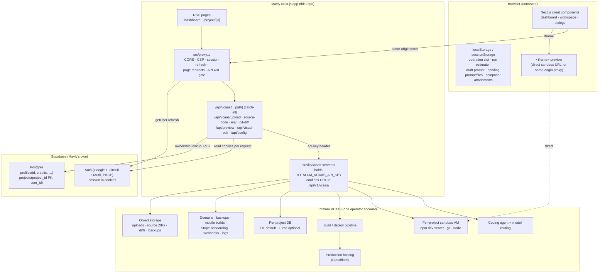
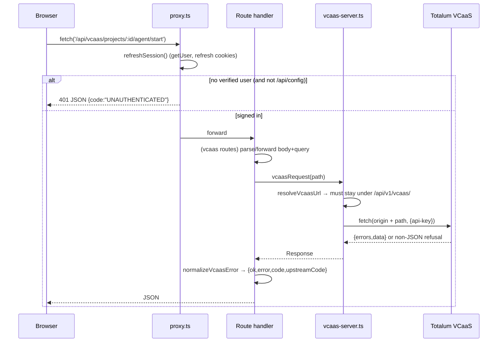
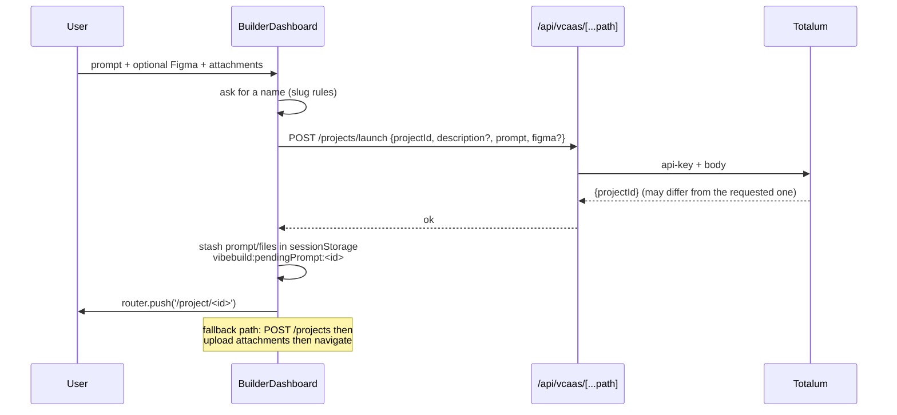
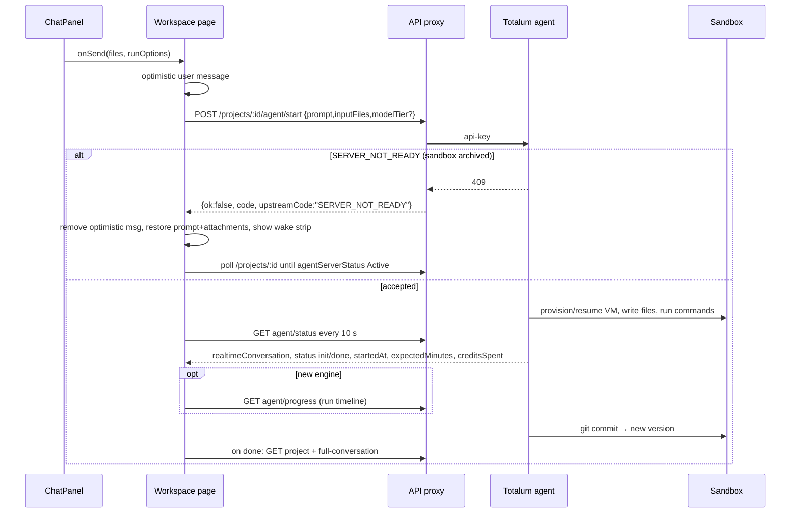
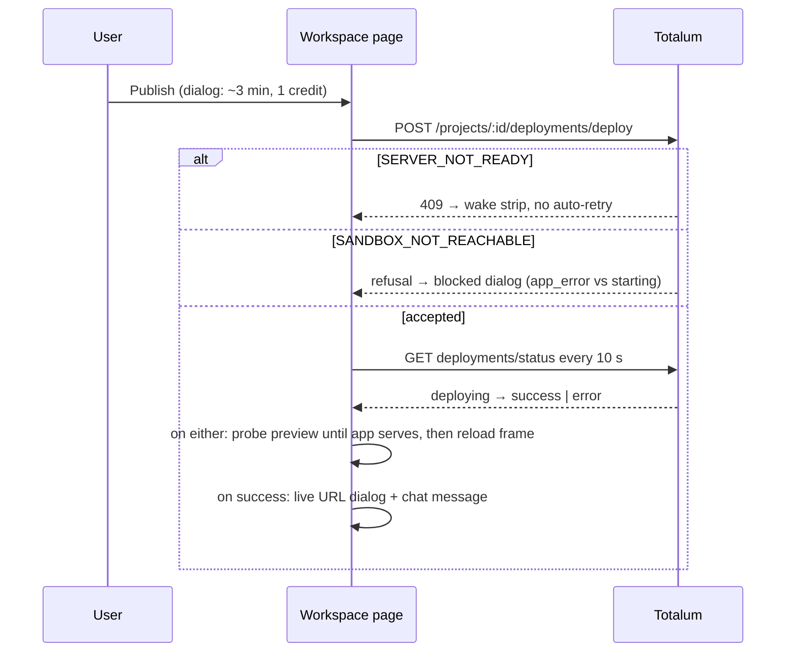
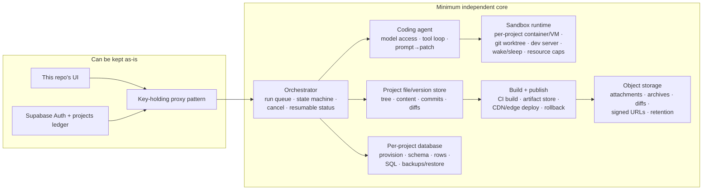

# Mavly — Product Architecture Reality Audit

> **HISTORICAL DOCUMENT — NOT CURRENT INSTRUCTIONS.** This audit describes the product
> while it was still a thin UI over the hosted Totalum VCaaS API. That integration has since
> been removed and the backend is intentionally disconnected. Statements below about Totalum
> being the runtime, about `src/lib/vcaas-server.ts`, or about upstream capabilities are no
> longer true. For the current state, read `MAVLY_CLEAN_BASELINE.md`.

**Scope:** the repository as it stands today (`npm test` 104/104, `tsc --noEmit` clean, `next build` green).
**Method:** static reading of every route, page, component and lib that participates in auth, project creation, prompting, preview, persistence, publishing, versions and data access. No live Totalum calls, no SQL, no deploys, no paid operations.
**Evidence labels:** **[C]** confirmed in this repo · **[I]** inferred from comments/types/config (not executable here) · **[?]** unknown from this repo.

---

## 1. Verdict in one page

Mavly is a **complete, opinionated product UI wrapped around a single-tenant Totalum VCaaS account**. It is *not* an independent AI website-builder backend. The parts that make the product real — the coding agent, the sandbox VM, the dev server, builds, publishing, hosting, databases, backups, domains, mobile builds, payments onboarding — all live behind `https://builder-api.totalum.app/api/v1/vcaas` and are reached with **one operator API key** (`TOTALUM_VCAAS_API_KEY`). **[C]** (`src/lib/vcaas-server.ts:20,92-93`, `src/app/api/vcaas/[...path]/route.ts`)

What Mavly genuinely owns:

| Owned here | Where |
|---|---|
| Authentication and session (Supabase OAuth, cookies) | `src/lib/supabase/*`, `src/lib/auth/*`, `src/app/auth/*`, `src/proxy.ts` |
| Page-level access control | `src/proxy.ts:104-215` |
| A tenancy ledger: `public.projects(project_id, user_id)` + RLS | `supabase/migrations/02_create_projects.sql` |
| Ownership enforcement on two routes (preview proxy, visual-edit apply) | `src/app/api/vcaas/_shared.ts:224-290` |
| The entire workspace UX: chat, preview frame, code editor, visual editor, dialogs | `src/app/project/[projectId]/page.tsx`, `src/components/workspace/*` |
| A same-origin preview proxy that injects the visual-editor agent | `src/app/api/preview/[projectId]/[[...path]]/route.ts` |
| Visual-edit → source-file transform | `src/app/api/visual-edit/[projectId]/apply`, `src/lib/visual-edit*.ts` |
| Attachment UX + upload size policy | `src/lib/upload.ts`, `src/components/workspace/ChatPanel.tsx` |
| Long-operation persistence and recovery (localStorage slot) | `src/lib/project-operation.ts`, `use-project-operation.ts` |

What it does **not** own: users' credits (they are Totalum account credits), the model, the agent loop, the sandbox lifecycle, the build system, the production host, the database engine, backups, domain registration/DNS, Stripe onboarding, mobile builds. **[C]** for the absence of any such dependency in `package.json`; **[C]** for the proxy topology.

Second, current-state caveat: **Phase 2 is only half-wired.** Every `/api/*` path now requires a session **[C]**, but only `/api/preview/*` and `/api/visual-edit/*` check *project ownership* **[C]**. The catch-all, upload, source-code, env and git-diff routes are session-gated but not project-scoped — and because the upstream key is account-wide, any signed-in user can act on any project id. This is the remaining F-1 hole and it is scheduled for Phase 3.

Third, a subtle live regression from Phase 2: **nothing inserts a row into `public.projects` on project creation** (`rg '\.insert\(' src` finds only the lookup) **[C]**. So a project created through the dashboard today has no ownership row, and the *visual editor* (the only consumer of the preview/apply guards) will 403 for it until Phase 3 wires the insert. Normal preview and prompting are unaffected (they do not use that proxy). The operator-backfilled project is the only one that currently passes.

---

## 2. System context

Legend: solid = confirmed in code; the Cloudflare/D1/Turso edges are **[I]** — the repo only contains endpoint names, types and comments about them (`src/lib/logs.ts:15`, `src/lib/vcaas-types.ts:687`, `src/lib/visual-edit-upgrade.ts:141`, `vcaas.ts:908-950`).

### 2.1 Trust boundaries

| Boundary | Control | Evidence |
|---|---|---|
| Browser → Mavly pages | Supabase session; signed-out → `/login?redirect=…` | `src/proxy.ts:196-216`; `src/lib/auth/redirect.ts` |
| Browser → `/api/*` | Session required; JSON 401 otherwise; only `/api/config` public | `src/lib/api-access.ts`; `src/proxy.ts:151-193` |
| API → Totalum | Operator key added server-side; URL resolved and confined to `/api/v1/vcaas/` | `vcaas-server.ts:54-80,107-142` |
| Caller → project | `public.projects` row + `enforceProjectScope` — **only preview + visual-edit** | `_shared.ts:117-290` |
| Preview proxy → sandbox | Origin resolved server-side from the project; redirects off-origin refused; `set-cookie` stripped | `src/app/api/preview/[projectId]/[[...path]]/route.ts` |
| Diff proxy → storage | Host allow-list + async DNS/private-range rejection + no redirects + timeout + 10 MB cap | `src/app/api/vcaas/git-diff/route.ts:24-104` |
| Embedding | `Content-Security-Policy: frame-ancestors *` | `src/proxy.ts:52-56` **[risk note]** |
| CORS | dev: any origin; prod: `NEXT_PUBLIC_APP_URL`, `*.totalum-project.com`, same host; credentials allowed | `src/proxy.ts:19-49` |

---

## 3. Request path (who answers what)

Only eight local API routes exist **[C]**:

| Route | Purpose | Auth today | Ownership today |
|---|---|---|---|
| `/api/config` | `{configured:boolean}` only | public | n/a |
| `/api/vcaas/[...path]` | JSON proxy for ~all product operations | session | **no** |
| `/api/vcaas/upload/[projectId]` | multipart → `files/upload` | session | **no** |
| `/api/vcaas/source-code/[projectId]` | signed URL → ZIP bytes | session | **no** |
| `/api/vcaas/env/[projectId]` | plain-text `.env` dev/live | session | **no** |
| `/api/vcaas/git-diff` | signed diff URL → text (SSRF-guarded) | session | n/a (URL is the input) |
| `/api/preview/[projectId]/[[...path]]` | same-origin preview + agent injection | session | **yes** |
| `/api/visual-edit/[projectId]/apply` | apply DOM edits to source files | session | **yes** |

---

## 4. Product flows

### 4.1 Sign-in and session

- Google/GitHub OAuth via Supabase; `redirectTo` is a **bare** `${origin}/auth/callback` (no query) and the intended destination rides in an HttpOnly one-time cookie. **[C]** (`src/lib/auth/oauth-url.ts`, `oauth.ts`, `callback.ts`)
- No app-supplied `state` is sent to the provider (PKCE owns it). **[C]**
- Session refresh + cookie write happens in `src/proxy.ts`; pages read with `getUser()`. **[C]** (`src/lib/supabase/proxy.ts`, `server.ts:117`)
- First sign-in creates `auth.users`; a trigger `on_auth_user_created` inserts `public.profiles` row (`credits` defaults 0). **[C]** (`01_create_user_profiles.sql:71-102`)
- `profiles.credits` is **never read or written by the UI**. There is no billing code, no Stripe dependency, no webhook. **[C]** (`rg` over `src`)
- The app fails closed when Supabase env is absent: builder pages redirect to `/login?error=not_configured`. **[C]** (`src/proxy.ts:198-205`)

### 4.2 Create a project (dashboard)

Evidence: `BuilderDashboard.tsx:404-531`, `vcaas.ts:336-410`, `page.tsx:861-881`.
**Persistence gap [C]:** no `INSERT INTO public.projects` after launch/create. Ownership rows exist only from the manual backfill.

### 4.3 Prompt → generation

Evidence: `ChatPanel.tsx:597`, `page.tsx:653-711`, `496-535`, `vcaas.ts:452-510`, `use-server-wake.ts`.
- Run options are optional: legacy `model`/`effort`/`fastMode`; v2 `modelTier` auto/cheap/normal/expensive. `normalizeRunOptions` drops defaults so upstream routing decides. **[C]** (`src/lib/run-options.ts`)
- Stop is confirmed first, POSTs `agent/stop`, and is not resumable. **[C]** (`ChatPanel.tsx:840-852`, `page.tsx:1148`)
- Attachments are uploaded first to Totalum storage and passed as `inputFiles[]` URLs; 8 MB per file client-side, upstream ~12 MB nginx limit. **[C]** (`lib/upload.ts:29-36`, `api/vcaas/upload`)

### 4.4 Reload / recovery (the strongest part of the UI)

| Signal on load | Behaviour | Evidence |
|---|---|---|
| `agentProcessStatus === "init"` | resume agent polling (10 s) | `page.tsx:593` |
| `deployment.status === "deploying"` | resume deploy polling | `page.tsx:594` |
| `rebuild/status` running with no local stamp | adopt `rebuild` banner | `page.tsx:596-604` |
| `importInProgress` | adopt `import` overlay with server `startedAt` | `page.tsx:606-615` |
| `versionRecovery` | restore watcher via project poll | `page.tsx:991-999` |
| operation slot in `localStorage` | restored and watched (8 s, 60 attempts) | `lib/project-operation.ts:307,453-471` |
| run estimate in `localStorage` | progress bar resumes with engine estimate | `page.tsx:383-396` |
| composer attachments in `localStorage` | restored per project | `page.tsx:852-859` |
| pending first prompt in `sessionStorage` | auto-sent once when idle | `page.tsx:865-881` |
| tab stale >5 min and hidden→visible | re-read project; may swap live URL→snapshot | `page.tsx:809-845` |
| no live server + project touched | start/restart server once, show wake strip | `page.tsx:735-793` |

Not recovered: the diff modal, open dialogs, `sending` state, chat scroll position, visual-editor batch (by design).

### 4.5 Preview

- Normal viewing: iframe points **directly** at the sandbox URL chosen by `developmentUrlFieldToUse` (default `temporalDevelopmentProjectUrl`), never cached. **[C]** (`page.tsx:55-64`, `PreviewPanel.tsx:70-84`)
- Sleeping server: upstream recommends `cachedDevelopmentUrl`; the frame shows the static snapshot with “Cached snapshot · server sleeping”. **[C]** (`PreviewPanel.tsx:58-66`)
- First build: the live URL exists before the app serves, so the frame shows the build loader until a `finished` message exists. **[C]** (`page.tsx:1303-1320`)
- Visual editing only: iframe swaps to `/api/preview/:id` (same origin), which fetches the resolved sandbox origin, rewrites HTML/CSS, injects the agent, strips `set-cookie`. **[C]**
- Route explorer reads the **free** `files/tree`, not the charged source archive. **[C]** (`PathPicker`, `vcaas.ts:737-749`)

### 4.6 Publish

Evidence: `page.tsx:1161-1196,548-586`, `DeployControl.tsx`, `vcaas.ts:514-535`.
Published host fallback: custom domain if active, else `productionProjectUrl`, else `<projectId>.totalum-project.com` **[C]** (`project-status.ts:335-346`).
Hosting provider: **Cloudflare [I]** — `src/lib/logs.ts:15` states the published project runs on Cloudflare; prod logs come from a Logpush worker (`vcaas.ts:812-820`). Not verifiable from this repo.

### 4.7 Versions, diffs, restore

- `GET /versions?limit&skip` → body `{versions,totalCount}` (real pagination). **[C]**
- Diff: prefer the stored `gitDiffUrl` from a finished message (works asleep, via SSRF-guarded proxy); otherwise `GET /version-diff?commitSha=` which needs a running sandbox. **[C]** (`page.tsx:1274-1296`, `VersionsModal.tsx:124`, `DiffViewer.tsx:131`)
- Restore: `POST /versions/:id/recover`, then poll the project until `versionRecovery` disappears or errors. **[C]** (`page.tsx:1253-1272,991-999`)

### 4.8 Database, backups, domains, payments, mobile

- Database explorer (v2 only): schema, rows, raw SQL (base64), plain-language questions, migrations, backups/restore, D1→Turso move. **[C]** (`vcaas.ts:896-950`, `components/workspace/database-v2/*`)
- Engines: `provider: "d1" | "turso"` **[C]** (`vcaas-types.ts:687`); default D1, optional migration **[I/C]**.
- Backups: list/create/restore/delete/download. **Download UI is broken**: `BackupsPanel.tsx:19-20` builds a link to `/api/vcaas/backup-download/...`, which does not exist; the working call is the JSON endpoint `vcaas.ts:935` returning a signed 15-minute URL. **[C]**
- Domains: attach/remove per project; account-level registry buy/renew/transfer/DNS/forwarding; prefix (`www`/`app`/apex) semantics. All upstream. **[C]** (`vcaas.ts:635-643,1059-1099`)
- Payments: Stripe **Connect onboarding** for the generated app — not Mavly billing. **[C]** (`vcaas.ts:1011-1022`)
- Mobile: Codemagic builds, store uploads. Upstream. **[C]** (`vcaas.ts:1024-1057`)
- Project transfer: export/import/duplicate, async and destructive; import has its own server-held lock (`importInProgress`). **[C]** (`vcaas.ts:427-447`, `page.tsx:973-989`)

---

## 5. State and storage ownership matrix

| Data | Lives in | Survives reload | Survives device change | Mavly controls it | Evidence |
|---|---|---|---|---|---|
| Auth session | cookies (Supabase) | yes (refreshed) | yes | yes | `supabase/*`, `proxy.ts` |
| User profile | Supabase `profiles` | yes | yes | table only; never used by UI | migration 01 |
| Project ownership | Supabase `projects` | yes | yes | yes, manual backfill only | migration 02 |
| Project list/detail | Totalum | yes | yes | no | `GET /projects[/:id]` |
| Conversation history | Totalum (1000-msg cap) | yes | yes | no | `vcaas.ts:458-484` |
| Run status / progress | Totalum | yes | yes | no | `agent/status`, `agent/progress` |
| Project files / versions | Totalum sandbox git | yes | yes | no | `files/*`, `versions/*` |
| Uploaded attachments | Totalum storage | yes (URL persisted in message.files) | yes | no | `upload`, `page.tsx:145-155` |
| Source ZIP / diffs | Totalum signed storage | n/a | n/a | no | `source-code`, `git-diff` |
| Project database | Totalum (D1/Turso) | yes | yes | no | `database/*` |
| Backups | Totalum storage | yes | yes | no | `database/backups` |
| Published site | Cloudflare **[I]** | yes | yes | no | `logs.ts:15` |
| Domains/DNS | Totalum + registrar | yes | yes | no | `domains/*` |
| Credits | Totalum account | yes | yes | no | `credit-costs`, `INSUFFICIENT_CREDITS` |
| Operation slot | `localStorage` | yes | no | yes | `project-operation.ts` |
| Run estimate | `localStorage` | yes | no | yes | `page.tsx:383-396` |
| Composer attachments | `localStorage` | yes | no | yes | `composer-attachments.ts` |
| Draft / first prompt / pending files | `sessionStorage` | no (tab) | no | yes | `BuilderDashboard.tsx:177-192,475-528` |
| UI prefs (chat width, dark mode, tab) | React state | no | no | yes | `page.tsx` |
| Open dialogs, diff viewer, visual batch | React state | no | no | yes | `page.tsx` |

---

## 6. Provider / model / infrastructure matrix

| Question | Answer | Confidence | Evidence |
|---|---|---|---|
| Which LLM provider/model builds apps? | Server-side routing by Totalum; not named client-side. Legacy names `sonnet`/`opus` and “fast mode is Opus-only” imply Anthropic. | **[I]** | `run-options.ts:34`, `vcaas.ts:490-497` |
| Can a user pick a model? | Legacy: model + effort + fast mode. v2: tier Auto/Cheap/Normal/Expensive only. | **[C]** | `run-options.ts`, `RunOptionsMenu.tsx` |
| Where does generation run? | A per-project sandbox VM with a git worktree and npm dev server. | **[C]** endpoint semantics + **[I]** VM detail | `agent/*`, `rebuild`, `logs` (dev = `npm-start.log` on sandbox) |
| What serves the dev preview? | The project’s own `npm start`/dev server on the sandbox, reached directly by the iframe. | **[C]** | `PreviewPanel`, `vcaas.ts:816-818` |
| What builds/serves production? | Next build deployed to Cloudflare (OpenNext). | **[I]** | `logs.ts:15`, `visual-edit-upgrade.ts:141` |
| Production URL | `<projectId>.totalum-project.com` or custom domain; `productionProjectUrl` may already include scheme. | **[C]** | `project-status.ts:335-346` |
| Database engine | D1 by default; Turso optional via one-way migration. | **[C]** types/endpoints, **[I]** defaults | `vcaas-types.ts:687`, `vcaas.ts:912-914` |
| Image CDN for uploads/previews | Not stated in code. `next.config.ts` allows `placeholders.io` and `ik.imagekit.io` (hero art is ImageKit-hosted). | **[?]** for project assets | `next.config.ts:8-21`, `HeroSection.tsx:25` |
| Email/payments/analytics for generated apps | Provided by upstream features (webhooks, Stripe Connect, site analytics). Mavly only renders controls. | **[C]** endpoints | `vcaas.ts:952,1011-1022` |
| Mavly billing | None. | **[C]** | no Stripe dep/route |
| Deployment target of Mavly itself | Vercel (`vercel.json`, `VERCEL=1` branch) or self-hosted Node (`output: standalone`). | **[C]** | `vercel.json`, `next.config.ts:5-11` |

---

## 7. Lifecycle / failure-behaviour matrix

| Event | Prompt run | Publish | Rebuild | Restore | Preview |
|---|---|---|---|---|---|
| Page refresh mid-run | polling resumes from `agentProcessStatus`; chat re-fetched | deploy poll resumes from `deployment.status` | banner adopted from server status | watcher resumes via `versionRecovery` | frame reloads; cached snapshot if asleep |
| Close tab | run continues upstream | deploy continues | rebuild continues | restore continues | — |
| Network drop during send | optimistic message stays; send returns error toast, no auto-retry | 10 s poll simply retries | 8 s watcher retries (60×) | 8 s watcher retries | iframe shows browser error |
| Sandbox archived | 409 `SERVER_NOT_READY` → prompt restored, wake strip | same → wake strip, no auto-deploy | fails; wake path | same | cached snapshot banner |
| Two tabs | operation `storage` event keeps slots in sync | same | same | same | independent frames |
| Stale tab (>5 min) | — | — | — | — | project re-read; live URL may swap to snapshot; wake requires a click |
| User not signed in | API 401 JSON | 401 | 401 | 401 | 401 (proxy) |
| Supabase unconfigured | pages redirect to login with `not_configured` | — | — | — | — |

---

## 8. Findings worth acting on (read-only observations)

**Critical / security**

1. **F-1 remainder [C].** `/api/vcaas/[...path]`, `upload`, `source-code`, `env`, `git-diff` require a session but not project ownership. With one account-wide key, any signed-in user can read/write/publish any project id. Guarded: preview + visual-edit only. Phase 3.
2. **Failure mode of the phase boundary [C].** No code writes the `projects` ownership row. New projects will 403 in the visual editor and visual-edit apply until Phase 3. This is not theoretical: the guard is real and the insert is absent.
3. **F-4 [C].** `src/app/api/vcaas/source-code/[projectId]/route.ts:44` fetches `downloadUrl` with no `publicUrlRejectionReason`, no `redirect:"error"`, no timeout, and buffers the entire ZIP (`arrayBuffer()`). Upstream-supplied, but a compromised/misconfigured upstream turns this into an SSRF + memory sink. Also: the client’s `intent` is **dropped** — the route always calls `/projects/:id/source-code` with no intent, while the client’s default is `view` and upstream’s default is `download` (`vcaas.ts:1134-1145`). That likely spends a download-credit/intent for a view.
4. **Embeddability [C].** `frame-ancestors *` plus credentialed CORS means any site can frame the app. Supabase cookies are SameSite=Lax by default, so cross-site POSTs are generally not credentialed, but this is a deliberate weakening worth revisiting for production.

**Correctness**

5. **Conversation windowing is documented but not implemented [C].** `vcaas.ts:458-483` claims the proxy slices by `limit`/`offsetFromEnd`; the catch-all does not. `page.tsx:461` requests the full history with no limit. Result: up to 1000 messages / multi-MB on every load and after every run.
6. **`response.meta` never exists [C].** The type and comments promise `X-Total-Count`/`X-Has-More` folded into the envelope (`vcaas.ts:105-129`); the catch-all forwards no response headers and returns only `{ok,data}`. Anything relying on `meta` silently falls back.
7. **F-8 backup download [C].** UI link points at a non-existent route; the real endpoint returns a signed URL. One of the two must change.
8. **`projects.list()` has no default limit at the dashboard call site [C]** (`BuilderDashboard.tsx:317`); whether the upstream returns everything or a server default is **[?]**. Name sorting already fetches 100 rows, so at small scale it is invisible.
9. **Deploy status has no timeout [C]** — `pollDeployOnce` re-arms every 10 s with no attempt cap (`page.tsx:585`); a stuck `deploying` polls until the tab closes.

**Documentation drift**

10. **AGENTS.md is stale [C]:** it says `_shared.ts` guards are “deliberate no-ops” and that API routes are open. Both are false since Phase 2. It also says `/api/*` is unauthenticated in the boilerplate section. This matters because AGENTS.md is the operating manual for future work.
11. **`.env.example` ships a real-looking Supabase project URL + publishable anon key [C].** The key is public by design and RLS is the control, but the example doubles as a live deployment's config; consider placeholders, and never add the service-role key.

---

## 9. Minimum independent architecture

To make Mavly standalone — i.e. to build and host websites itself — these are the capabilities that must exist *outside* Totalum. The UI can stay almost unchanged if each one keeps the same contract.

**Non-negotiables if the UI is to stay unchanged**

- Same `/api/vcaas/*` envelope `{ok,data}` / `{ok:false,error,code,upstreamCode}` and the same paths (or a compatibility layer).
- Pollable `agent/status` with `status`, `startedAt`, `expectedMinutes`, `realtimeConversation`, `creditsSpent`.
- `agent/progress` stage timeline for the new-engine loader.
- `developmentUrlFieldToUse` semantics (`temporalDevelopmentProjectUrl` vs `cachedDevelopmentUrl`) and a real `agentServerStatus`.
- `SERVER_NOT_READY` + `SANDBOX_NOT_REACHABLE` refusals, because the wake/blocked UX keys on them.
- `importInProgress`, `versionRecovery`, `deployment.status` shapes.

**Migration sequence (reversible, one capability at a time)**

1. **Ownership completeness (Phase 3).** Insert `projects` rows on launch/create; add `enforceProjectScope` to catch-all/upload/source-code/env/git-diff; decide the account-scoped allow-list (`GET /projects`, `credit-costs`, `figma/validate`, `webhooks`, `domains`, `usage`, `credit-limits/at-limit`). *No upstream change; this is the prerequisite for multi-tenancy.*
2. **Backup download + F-4 hardening (Phases 4–5).** One route, validated URL, streaming cap, correct `intent`.
3. **Control-plane abstraction.** Introduce a server-side `BuilderBackend` interface (projects, runs, files, versions, deploy, db, storage). Implement it with Totalum today; keep the UI on the interface. This is the seam that makes the rest swappable without touching components.
4. **Object storage + file/version store.** Move uploads and archives to owned storage; keep the same `{url,fileNameId}` and tree/content contracts. Design diffs as stored objects, not a sandbox `git diff`.
5. **Sandbox runtime.** Start with a single-node container-per-project runtime (git worktree, `npm dev`, wake/sleep, per-project quotas), reproduce `agentServerStatus` and `SERVER_NOT_READY`.
6. **Agent.** Point the tool loop at the owned sandbox and file store; keep model choice server-side. Preserve `status`, `progress`, `conversation`, `inputFiles`.
7. **Build/publish.** Reproduce `deployments/deploy` + `deployments/status` with a CI build and edge/CDN upload; keep the ~1 credit → now your own metering.
8. **Database service.** Provision per-project DBs; implement the v2 explorer endpoints (`schema`, `rows`, `sql`, `ask`, `bookmarks`, `backups`, restore) or hide those screens behind a capability flag.
9. **Domains/payments/mobile.** Optional; each is already isolated behind its own dialog and can be feature-flagged.
10. **Metering/billing.** Finally use `profiles.credits`; gate the expensive paths server-side; wire a checkout. Today `profiles.credits` is a placeholder.

---

## 10. Questions this repository cannot answer

1. **Which model/provider** actually generates code today, and what the v2 tiers map to. Only server-side routing names (`sonnet`, `opus`, tiers) are visible.
2. **Exact production hosting** (Cloudflare Workers vs Pages, regions), artifact retention, and rollback semantics. Only comments and the `opennextjs/cloudflare` reference hint at it.
3. **Sandbox implementation** (Firecracker/gVisor/plain containers), CPU/RAM caps, and the archive schedule. The UI knows the *states*, not the machinery.
4. **Database engine per existing project** (D1 vs Turso) and whether backups are logical dumps or snapshots. The API shape suggests dumps (`.sql`/`.sql.gz`), but this is **[I]**.
5. **Upstream data retention** for conversations, uploads, ZIPs and diffs; whether deleting a project deletes its storage.
6. **Upstream rate limits and credit prices** beyond what `/credit-costs` returns at runtime.
7. **Whether `GET /projects` paginates by default**, and its maximum page size.
8. **The intended multi-tenant model** — one Totalum account with a Mavly ownership table (today), or one upstream account per customer. Nothing in the repo decides this; the README describes `projectId ↔ tenant` as the pattern, but the implementation is still single-key.
9. **Whether the Supabase project in `.env.example` is the production project** (it looks like a real ref) and who holds its dashboard access.

---

## 11. Evidence index (primary citations)

| Concern | File:line |
|---|---|
| Totalum origin + key custody | `src/lib/vcaas-server.ts:20,54-80,92-93,107-142` |
| Catch-all proxy + error envelope | `src/app/api/vcaas/[...path]/route.ts:32-135` |
| API session gate | `src/proxy.ts:151-193`; `src/lib/api-access.ts` |
| Page session gate | `src/proxy.ts:104-216` |
| CORS / CSP | `src/proxy.ts:19-56` |
| Ownership lookup + guards | `src/app/api/vcaas/_shared.ts:95-290` |
| Ownership schema/RLS | `supabase/migrations/02_create_projects.sql:23-96` |
| Profile trigger | `supabase/migrations/01_create_user_profiles.sql:71-102` |
| Workspace init / recovery | `src/app/project/[projectId]/page.tsx:587-618,809-845` |
| Wake-on-touch | `src/app/project/[projectId]/page.tsx:214-230,735-793` |
| Prompt send / restore-on-refusal | `src/app/project/[projectId]/page.tsx:653-711` |
| Agent polling | `src/app/project/[projectId]/page.tsx:496-535` |
| Publish + deploy polling | `src/app/project/[projectId]/page.tsx:548-586,1161-1196` |
| Operation watcher | `src/app/project/[projectId]/page.tsx:902-1014`; `src/lib/project-operation.ts:307,453-471` |
| Preview URL selection | `src/app/project/[projectId]/page.tsx:55-64`; `src/lib/project-status.ts:335-346` |
| Preview panel / snapshot badge | `src/components/workspace/PreviewPanel.tsx:58-84` |
| Preview proxy + agent injection | `src/app/api/preview/[projectId]/[[...path]]/route.ts:1-200` |
| Source ZIP (F-4) | `src/app/api/vcaas/source-code/[projectId]/route.ts:15-56` |
| Upload policy | `src/lib/upload.ts:29-36`; `src/app/api/vcaas/upload/[projectId]/route.ts:68-110` |
| Conversation paging (claim vs reality) | `src/lib/vcaas.ts:105-129,458-484`; `src/app/project/[projectId]/page.tsx:461` |
| Versions / diff / restore | `src/lib/vcaas.ts:649-681`; `VersionsModal.tsx:124`; `DiffViewer.tsx:131` |
| Database / backups | `src/lib/vcaas.ts:896-950`; `components/workspace/database-v2/BackupsPanel.tsx:19-20` |
| Domains / payments / mobile | `src/lib/vcaas.ts:635-643,1011-1099,1024-1057` |
| Cloudflare hosting hint | `src/lib/logs.ts:15`; `src/lib/visual-edit-upgrade.ts:141` |
| Deployment config | `vercel.json`; `next.config.ts:5-36` |
| Env contract | `.env.example` (names only) |
| Tests / gates | `package.json` scripts; `tests/*.test.ts` |
